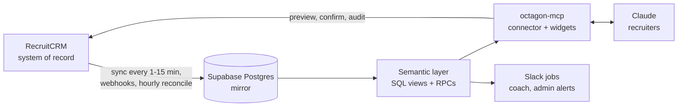

# Octagon Recruitment Analytics Platform

For a developer or admin working on the platform: what it is, how the repo is laid out, and how a change reaches production.

*Last reviewed 04/11/2026.*

Octagon Analytics keeps a live mirror of the firm's RecruitCRM data in Supabase, defines every
metric once in SQL, and serves it to recruiters through Claude: a remote MCP connector
(`octagon-mcp`) answers questions, renders the dashboard and report widgets, and makes audited
write-backs to RecruitCRM, while scheduled jobs send coach nudges and admin alerts to Slack. RecruitCRM stays the system of record; nothing is written to the mirror directly.

**User and operator documentation lives in the [knowledge base](https://docs.octagongroup.co.uk)** (source in `site/`).
This README covers the repository.

On this page: [How it fits together](#how-it-fits-together) ·
[Repository layout](#repository-layout) · [Deploying](#deploying) ·
[Supabase project](#supabase-project) · [Security](#security) · [Operating it](#operating-it) ·
[Key findings](#key-findings) · [Status](#status)

| I want to… | Go to |
|---|---|
| Use the platform as a recruiter | [Onboarding](https://docs.octagongroup.co.uk/use/getting-started/) |
| Find a command or a tool | [Commands](https://docs.octagongroup.co.uk/use/commands/), [Tools Reference](https://docs.octagongroup.co.uk/run/tools/) |
| Know what a number means | [Metrics and Definitions](https://docs.octagongroup.co.uk/use/metrics/) |
| Know where numbers are soft | [Data Caveats](https://docs.octagongroup.co.uk/use/data-caveats/) |
| Understand the design | [Architecture](https://docs.octagongroup.co.uk/run/architecture/), [`docs/DECISIONS.md`](docs/DECISIONS.md) |
| Deploy, backfill, mint a token | [Operations Runbook](https://docs.octagongroup.co.uk/run/runbook/), [CONTRIBUTING.md](CONTRIBUTING.md) |
| Set up as an admin or developer | [ONBOARDING.md](ONBOARDING.md) |
| Report a security problem | [SECURITY.md](SECURITY.md) |

---

## How it fits together



- **RecruitCRM is the single source of truth** ([D8](docs/DECISIONS.md)). Writes go back to
  RecruitCRM through its API, then a write-through refresh updates the mirror within seconds.
- **One semantic layer.** The connector, its widgets and the Slack jobs read the same views and
  functions, so their numbers cannot disagree.
- **Activity is credited to the actor**, whoever moved the stage; calls to the caller; billing to
  the deal owner. Leavers keep their history and are tagged "left".
- **2026 is the reliable reporting window.** Hiring-stage logging before 2026 is sparse in
  RecruitCRM, so reports default to 2026 year to date.

## Repository layout

| Path | What is there |
|---|---|
| `supabase/migrations/` | Schema, semantic layer, RPCs, RLS and cron, numbered `0001`–`0158`. Next is `0159` |
| `supabase/functions/octagon-mcp/` | The MCP connector: 80 tools and 26 prompts, the OAuth bridge, MCP Apps widgets (`widgets.ts`, `ext_apps_bundle.ts`). Version 3.101.0 |
| `supabase/functions/recruitcrm-sync/` | The mirror: backfill, incremental, reconcile, history, notes, off-limit, meetings, assignment sweep |
| `supabase/functions/recruitcrm-webhook/` | Near-live change trigger from RecruitCRM; tombstones on `*.deleted` events |
| `supabase/functions/coach-dm/`, `coach-actions/` | The Octagon Coach DMs and their buttons (separate Slack app) |
| `supabase/functions/inbox-sync/` | Polls connected Outlook inboxes through Microsoft Graph |
| `supabase/functions/digest-email/` | Renders the morning, evening and weekly digests as email. Not scheduled by any cron job |
| `supabase/functions/slack-command/` | Slack `/dashboard` and `/kpis` |
| `supabase/functions/feedback/` | Issue and feature capture from the connect page |
| `supabase/functions/_shared/` | `caller.ts` (who may call a locked function), `graph.ts` (Microsoft Graph) |
| `supabase/functions/dashboard/`, `dashboard-data/` | Retired 03/11/2026: 410 stubs with no data |
| `supabase/functions/recruitcrm-probe/`, `recruitcrm-discover/` | Throwaway API probes, locked; not part of the product |
| `supabase/config.toml` | `verify_jwt` per function, with the reason for each |
| `web/octagon-connect.html` | The connector's login page (token to OAuth handoff) |
| `scripts/` | Repo checks: widget bundle build, widget and connect-page checks |
| `rollout/` | Org instructions for claude.ai and recruiter templates |
| `slack/` | The Octagon Coach Slack app manifest |
| `plugins/` | Pointer only. The 83 slash commands live in [octagon-plugins](https://github.com/ollielarkins/octagon-plugins) |
| `site/` | The knowledge base (Astro Starlight), deployed to [docs.octagongroup.co.uk](https://docs.octagongroup.co.uk) by `.github/workflows/docs.yml` |
| `docs/DECISIONS.md` | Append-only design decision log |
| `ROADMAP.MD`, `PROJBRIEF.MD` | Roadmap with current status; the original brief, kept as history |

> [!IMPORTANT]
> The knowledge base in `site/` replaces the GitHub wiki (retired 09/11/2026). Edit pages in
> `site/src/content/docs/`; merging to `main` redeploys it. The Commands and Tools pages are
> generated from source, so never edit them by hand. See
> [Writing these docs](https://docs.octagongroup.co.uk/run/writing-docs/).

---

## Deploying

> [!WARNING]
> Never use `supabase db push`: the local file names do not match the remote migration history, so
> it would try to re-apply everything.

**Sign in first.** The Supabase CLI must be signed in to the account that owns the project
(`npx supabase login`). If `npx supabase projects list` doesn't show `kzcmssldvtjnbwwunuwm`, every
deploy and query returns 403. That is what happened on 04-05/11/2026: the CLI was signed in to a
different account, and it was not a lost permission.

**Migrations.** Apply with the Supabase MCP `apply_migration` tool, using the file's name
(`0151_short_name`) and its full contents, then commit the same file. Test risky SQL first; see
[CONTRIBUTING.md](CONTRIBUTING.md#migrations).

**Edge functions.** Deploy with the CLI, one function per command:

```bash
npx supabase functions deploy octagon-mcp --project-ref kzcmssldvtjnbwwunuwm --use-api --yes
```

- Never pass `--no-verify-jwt`: `verify_jwt` comes from `supabase/config.toml`, and the flag
  overrides it for every function in the command.
- The Supabase MCP `deploy_edge_function` tool also works for small functions (the coach ones), but
  it uploads file contents you pass by hand: send every file the entrypoint imports, with its real
  content, and set `verify_jwt` from `config.toml` (the tool defaults to `true`). It is not practical
  for `octagon-mcp` (about 920KB across four files). A placeholder string once took the connector
  down (10/08/2026).
- Bump `SERVER.version` in `octagon-mcp/index.ts`, then confirm the live build:

```bash
node --experimental-strip-types --check supabase/functions/octagon-mcp/index.ts   # before
curl -s --retry 8 --retry-delay 3 --retry-all-errors \
  https://kzcmssldvtjnbwwunuwm.supabase.co/functions/v1/octagon-mcp               # after: shows the version
```

When a change spans both, apply the migration first, then deploy the function that calls it.

---

## Supabase project

Project "Reporting for CRM", ref `kzcmssldvtjnbwwunuwm`, region `eu-west-1` (candidate PII stays in
the EU), Postgres 17.

| Function | `verify_jwt` | Auth and purpose |
|---|---|---|
| `octagon-mcp` | false | Per-user tokens in `mcp_tokens` (OAuth or bearer). The connector |
| `recruitcrm-sync` | true | Locked: service role or `CRON_SECRET`. The mirror |
| `recruitcrm-webhook` | false | Shared `?key=` secret. Near-live change trigger |
| `coach-dm`, `digest-email`, `inbox-sync` | true | Locked: service role or `CRON_SECRET`. Driven by `pg_cron` |
| `coach-actions`, `slack-command` | false | Slack request signature, each with its own app's signing secret |
| `feedback` | false | Public form: field validation, length cap, honeypot, per-IP rate limit. Stores submissions, serves no data |
| `dashboard`, `dashboard-data` | false | Retired 03/11/2026. Return 410 Gone and no data |
| `recruitcrm-probe`, `recruitcrm-discover` | true | Throwaway probes |

### Schedule

All times UK. The Slack jobs are scheduled at two UTC hours and send only at the right UK hour, so
they survive the clock change.

| When | Job |
|---|---|
| Every minute | Candidate stage history, the funnel's live feed |
| Every 3 min | Candidate deletion pass drain (passes start 05:40 and 18:40 UTC) |
| Every 5 min | Sync health watchdog; Outlook inbox poll |
| Every 10 min | Cron manifest watchdog: do the scheduled jobs still exist? |
| Every 15 min | Incremental sync of all entities; notes re-walk |
| Hourly | Reconcile clients :05, jobs :12, deals :18; off-limit refresh :25; assignment sweep :40 |
| Daily | Reconcile consultants 03:00 and contacts 03:20; inbox 30-day purge 03:20; meetings refresh 06:10; housekeeping purges |
| 07:30 daily | Sync health digest to the admin bot |
| 12:30, 16:45 weekdays; 08:45 Mondays | Octagon Coach DMs (shadow mode) |
| Fridays | Weekly usage table |

Add every new permanent job to `cron_manifest` in the same migration. As of 04/11/2026
`recruitcrm-assignment-sweep` and `weekly-usage-slack` run but are not declared in it.

## Security

The full model is in [SECURITY.md](SECURITY.md). In short: every connector call carries a per-user
token (stored only as a SHA-256 hash) that fixes who is acting; every write is preview then confirm
against a server-stored nonce, audited, and attributed in RecruitCRM via `updated_by`; locked
functions need the service-role key or `CRON_SECRET`; no unauthenticated endpoint has served firm
figures since 03/11/2026.

### Secrets

Set in Supabase function secrets, never in the repo. `.gitignore` excludes `.env`, `*.key` and
`secrets/`.

| Secret | Used by |
|---|---|
| `RECRUIT_CRM_API_TOKEN` | `recruitcrm-sync`, `octagon-mcp`, `coach-actions` |
| `CRON_SECRET` | Locked functions, via `_shared/caller.ts`; `pg_cron` sends it from Vault (0132) |
| `WEBHOOK_SECRET` | `recruitcrm-webhook`; `octagon-mcp` when it creates subscriptions |
| `SLACK_SIGNING_SECRET` | `slack-command` |
| `COACH_BOT_TOKEN`, `COACH_SIGNING_SECRET` | `coach-dm`, `coach-actions` (Octagon Coach app) |
| `MS_TENANT_ID`, `MS_CLIENT_ID`, `MS_CLIENT_SECRET` | `inbox-sync`, `octagon-mcp` (Microsoft Graph) |
| `RESEND_API_KEY`, `DIGEST_FROM`, `FEEDBACK_FROM`, `FEEDBACK_TO` | `digest-email`, `feedback` |

---

## Operating it

Full detail in the
[Operations Runbook](https://docs.octagongroup.co.uk/run/runbook/).
Admins can check most of this from Claude with `/health`, `/tokens` and `/usage`.

```sql
-- is anything stale?
select public.sync_health();

-- do the scheduled jobs still exist?
select public.check_cron_manifest();

-- mint a token (hand the plaintext over once; only the hash is stored)
insert into mcp_tokens (token_hash, consultant_recruitcrm_id, label, can_write, is_admin, active)
values (encode(digest('<plaintext>','sha256'),'hex'), <recruitcrm_id>, 'Name (Recruiter)', true, false, true);
```

Revoke with `/tokens` (preview, then confirm). Leavers are revoked automatically when RecruitCRM
marks them inactive (0136).

The Slack alert webhook lives in `app_settings`: `alert_webhook_url` (sync alerts only, the admin
bot). The coach DMs use the Octagon Coach app's bot token.

---

## Key findings

Why the numbers are what they are. Fuller treatment in
[Data Caveats](https://docs.octagongroup.co.uk/use/data-caveats/).

1. **Funnel parity with RecruitCRM's own report is capped at about 0.4%, and the cause is theirs.**
   The residual is events the API returns and their report omits. The platform matches the API,
   which is reproducible.
2. **Call KPIs count tagged calls only, so they understate.** Most Devyce calls arrive untagged.
   `/tagcalls` suggests a category per call, and since 0148 reports show a "likely BD / client"
   count for untagged calls beside the tagged count, never added in.
3. **The spreadsheet is a validation reference, not a source of truth** ([D8](docs/DECISIONS.md)).
   Ratios match; pre-2026 absolute counts do not, because that activity was never logged.
4. **Supabase cannot serve HTML** (edge functions force `text/plain`), which is one reason the
   dashboard now lives in the connector's own widget.
5. **There is no "Internal Interview" stage.** It means 3rd Interview.
6. **The client/BD funnel lives in the company "Company Status" custom field.** Contacts are
   mirrored since 03/11/2026 (0145), without email or phone.
7. **RecruitCRM does emit delete events**; the platform subscribes to the four `*.deleted` events
   and still reconciles hourly in case one is missed.

---

## Status

At 04/11/2026. The dated detail, including what is open, is at the top of [ROADMAP.MD](ROADMAP.MD).

| Area | Status |
|---|---|
| Data model, sync, semantic layer (M0–M3) | Done; contacts mirrored since 03/11/2026 |
| Dashboard (M4) | Done; in the connector's `get_dashboard` widget since 20/10/2026 |
| Claude query and action layers (M5, M6) | Done: 80 tools, 26 prompts, 82 commands, live audited writes since 12/08/2026 |
| Slack layer | Octagon Coach in shadow mode. Team Briefs app (briefs, queue DMs) removed 09/11/2026; `/queue` and `/exceptions` remain in Claude |
| Hardening (M7) | Partial: audit fixes 29/10–03/11/2026 shipped; no CI; items open in the roadmap |

**Related:** [Architecture](https://docs.octagongroup.co.uk/run/architecture/) · [Operations Runbook](https://docs.octagongroup.co.uk/run/runbook/) · [CONTRIBUTING.md](CONTRIBUTING.md) · [ROADMAP.MD](ROADMAP.MD)
