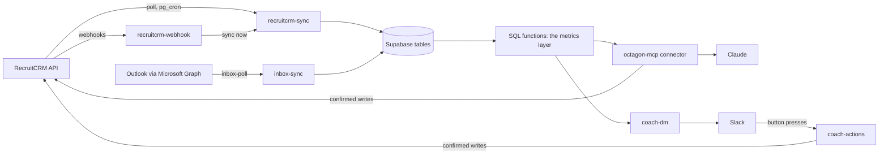

# Architecture

For anyone who needs to know how data gets from RecruitCRM to Claude and Slack, what each piece does and how it is protected.

*Last reviewed 04/11/2026.*

**On this page:** [Data flow](#data-flow) · [Edge functions](#edge-functions) · [What is mirrored](#what-is-mirrored) · [Sync](#sync) · [Webhooks](#webhooks) · [The metrics layer](#the-metrics-layer) · [The write path](#the-write-path) · [Security model](#security-model) · [Retired: dashboard and dashboard-data](#retired-dashboard-and-dashboard-data) · [Rendering](#rendering) · [Repo layout](#repo-layout) · [Known engineering gaps](#known-engineering-gaps)

## Data flow

RecruitCRM is the system of record. Supabase holds a read-only mirror of it, SQL functions turn the mirror into figures, and the `octagon-mcp` connector hands those figures to each person's Claude. Slack gets the same figures from the same functions. Writes go back to RecruitCRM, never to the mirror directly.



Reads always come from the mirror. After a write, the connector refreshes the affected records straight away, so the mirror does not lag behind a change you just made.

There is no AI on the server. Every piece of drafting happens in the person's own Claude; the Slack messages are rule-based.

## Edge functions

`verify_jwt` for every function is declared in `supabase/config.toml`, so it travels with the repo and a stray CLI flag cannot flip it. `verify_jwt = true` on its own is not enough, because the anon key is public: the locked functions also call `trustedCaller()` from `supabase/functions/_shared/caller.ts`, which accepts only the service-role key or an `x-octagon-cron` header equal to `CRON_SECRET` (see [Security model](#security-model)).

### Live

| Function | What it does | How it is protected |
|---|---|---|
| `octagon-mcp` | The connector: a remote MCP server (streamable HTTP), version 3.101.0, 80 tools and 26 prompts. Reads the metrics layer, writes to RecruitCRM on confirmation, serves the inline widgets | Open (`verify_jwt = false`). Every tool call authenticates a per-user Octagon token or OAuth session token against `mcp_tokens` |
| `recruitcrm-sync` | The mirror. Modes: `incremental`, `history_recent`, `notes_recent`, `reconcile`, `offlimit`, `assignment_sweep`, `meetings_quarter`, and per-entity backfill | Locked: JWT plus `trustedCaller()`. Holds the RecruitCRM API token |
| `recruitcrm-webhook` | Receives RecruitCRM's change notifications, logs them, tombstones deletions and fires an incremental sync for the entity | Open. Requires the shared `?key=` secret (`WEBHOOK_SECRET`) |
| `inbox-sync` | Polls connected Outlook inboxes through Microsoft Graph every 5 minutes. Stores envelopes only (sender, subject, time, thread, category), never bodies | Locked: JWT plus `trustedCaller()`. Holds the Graph app secret |
| `coach-dm` | The Octagon Coach DMs at 12:30, 16:45 and Monday 08:45 | Locked: JWT plus `trustedCaller()`. Holds `COACH_BOT_TOKEN` |
| `coach-actions` | The coach's buttons: Done, Snooze, Pause, Mute, Away date, and one-press call tagging (the only one that writes to RecruitCRM) | Open. Every request must carry a valid Slack signature (`COACH_SIGNING_SECRET`) |
| `slack-command` | Slack slash commands `/dashboard` and `/kpis` | Open. Verifies Slack's signature (`SLACK_SIGNING_SECRET`) before anything else |
| `feedback` | The issue and feedback box on the connect page | Open, by necessity. Field validation, a length cap, a honeypot and a per-IP rate limit |
| `digest-email` | Renders the morning, evening and weekly digests as email. Deployed, but not scheduled by any cron job | Locked: JWT plus `trustedCaller()` |
| `recruitcrm-probe` | Read-only API shape probe. Temporary | Locked: JWT plus `trustedCaller()` |

### Retired

| Function | State |
|---|---|
| `dashboard` | 410 Gone, no data, since 03/11/2026. Left open only so old links get a clear 410 |
| `dashboard-data` | 410 Gone, no data, since 03/11/2026. Same |
| `storage-upload` | Retired. No source in the repo; `verify_jwt = true` |
| `recruitcrm-discover` | 410 Gone stub, locked. Unused |
| `daily-queue`, `slack-actions` | Removed 09/11/2026 with the "(Claude) - Team Briefs" Slack app (0158) |

## What is mirrored

| Table | From RecruitCRM | Notes |
|---|---|---|
| `consultants` | Users | `recruitcrm_id` is the canonical identity; names are display only. Leavers stay, marked inactive |
| `clients` | Companies | Company status included |
| `contacts` | Contacts | Name, company, job title, owner. No email or phone, since 0145 |
| `jobs` | Jobs | Includes job custom fields (0090), so DPE scores and grades are reportable |
| `candidates` | Candidates | Includes the off-limit flag, end date and reason |
| `candidate_stage_events` | Hiring-stage history | The single source for the whole funnel |
| `candidate_assignments` | Candidate-job assignments | Caught by the history feed and an hourly sweep |
| `call_activity` | Devyce call logs | Metadata and category only: no phone numbers, no call notes |
| `deals` | Deals | Billing is Won deal value |
| `meetings` | Meetings | This quarter and last, refreshed daily |
| `notes` | Notes | What makes leads, internal interviews and job order forms countable |

Not mirrored: candidate CVs and files (read live when asked), Devyce call summaries (`call_notes` reads them live and never stores them), and email bodies.

`stage_lookup` maps RecruitCRM's integer stage ids to a `(stage_metric, stage_name)`. `audit_log` records every write.

## Sync

Polling is the guarantee; webhooks are the fast path. All jobs are `pg_cron`, and the full schedule is in the [Operations Runbook](Operations-Runbook#cron-schedule).

| Feed | How often |
|---|---|
| Incremental, all entities including contacts | Every 15 minutes |
| Candidate stage history (the funnel feed) | Every minute |
| Notes | Every 15 minutes |
| Off-limit flags | Hourly |
| Assignment sweep | Hourly |
| Deletion detection (reconciles) | Clients, jobs, deals hourly; consultants and contacts nightly; candidates twice a day |
| Meetings | Daily |

The incremental walk moves its watermark only after a complete walk. If it stops early (a 429 or the page cap), it saves its place in `sync_state.cursor` and resumes there, so it can re-read rows but never skip them.

Reconciles are full page-walks, because walking every record is the only way to spot a deletion by polling. They are staggered at :05, :12 and :18 so they do not contend. The candidate reconcile is a **pair**: `backfill-candidates-pass` resets the cursor and starts a walk, and `backfill-candidates-drain` resumes it every 3 minutes until done, when `retire_unseen_candidates` runs. Neither works alone.

## Webhooks

RecruitCRM pushes changes to `recruitcrm-webhook`, including `candidate.deleted`, `job.deleted`, `company.deleted`, `deal.deleted`, `candidate.hiringstage.updated`, `deal.stage.updated` and `job.status.updated`. Admins manage the subscriptions with `webhook_subscriptions`.

1. **RecruitCRM never names the event in the body.** We choose each subscription's `target_url`, so the event name rides on the URL (`?event=job.deleted`) and the handler reads it there.
2. **Routing is by record shape, not keywords.** The original router keyword-scanned the body, and job payloads contain `note_for_candidates`, so 68 job and 16 company payloads were routed to candidates. It now trusts the event name and falls back to distinctive top-level keys.
3. **Deletions are handled, not synced.** The incremental sync only walks records that still exist, so the row is tombstoned directly.

Deliveries get missed. The poll is what makes the mirror converge anyway.

## The metrics layer

Every figure comes from a SQL function or view: `dashboard_json`, `funnel_report`, `kpis_report`, `billing_report`, `my_day`, `fee_analysis`, `data_hygiene` and the rest. Nothing queries base tables ad hoc, which is what guarantees the dashboards, Slack and Claude cannot disagree. They are `security definer` and granted to `service_role` only.

Identity is `consultants.recruitcrm_id`. Funnel events go to the person who made the move, calls to the caller, billing to the deal owner. See [Metrics and Definitions](Metrics-and-Definitions).

## The write path

Every write tool is two-step: a preview, then a confirm that must match it.

```mermaid
sequenceDiagram
  participant C as Claude
  participant M as octagon-mcp
  participant DB as Supabase
  participant R as RecruitCRM
  C->>M: tool call without confirm
  M->>DB: store card_nonce, tool, person, exact args (mcp_card_previews)
  M-->>C: preview card
  C->>M: confirm=true + _card.confirm_args
  M->>DB: check nonce matches; mark used (mcp_card_confirms)
  M->>R: write, attributed to the consultant (updated_by)
  M->>R: read the change back
  M->>DB: audit_log row, refresh the mirror
  M-->>C: applied
```

- **The nonce is stored at preview** (0131). A confirm is applied only if its `card_nonce` was issued for the same tool, the same person and the exact arguments the preview offered, within 24 hours. A missing, invented or altered nonce gets `preview_required` or `preview_mismatch` and nothing changes.
- **Each nonce applies once** (`mcp_card_confirms`, 0103), so a re-rendered card, or a button press followed by "yes" in chat, cannot apply the same change twice.
- **Stage moves check for conflicts.** `update_hiring_stage` refuses if the candidate's stage has changed since the preview (`expected_status_id`).
- **Writes are read back** where RecruitCRM allows: client status, call tagging, deals, DPE scores and the website fields on jobs. `update_hiring_stage` refreshes the candidate's stage history in the mirror instead.
- **Extra guards.** Off-limit is checked live on every client-facing path and fails closed if it cannot be verified. Deletes need the record's name typed back (`confirm_name`). Batches are capped at 25 records per confirmation.

The Slack buttons follow the same rule: the message is the preview and the press is the confirmation, and only the records in that message are touched.

## Security model

| Control | What it does |
|---|---|
| Per-user tokens | `mcp_tokens` holds SHA-256 hashes only, each mapped to a consultant with `can_write`, `is_admin` and `can_view_usage`. Identity comes from the token on every call and can never be set by a tool argument |
| OAuth bridge | claude.ai needs OAuth, so the connect page exchanges a pasted Octagon token for an OAuth session token with the same rights (PKCE S256 required). Redirects are allowed only to claude.ai and claude.com's callback URLs |
| Leaver auto-revoke | When a consultant is marked inactive or deleted, a trigger (0136) switches off all their tokens, including OAuth sessions, and stops their inbox being polled, with an `audit_log` row. Admin tokens are never touched |
| `CRON_SECRET` | Locked functions accept only the service-role key or `x-octagon-cron` = `CRON_SECRET`. `pg_cron` sends it through `public.cron_headers()`, which reads it from Vault. Fails closed if unset |
| Slack signatures | `coach-actions` and `slack-command` reject any request without a valid Slack signature for their own app |
| Webhook secret | `recruitcrm-webhook` requires its `?key=` secret |
| Row-level security | Internal tables such as `mcp_card_previews` and `mcp_card_confirms` deny `anon` and `authenticated` outright |
| No PII in the mirror where avoidable | No contact emails or phones, no call notes, no email bodies |

## Retired: dashboard and dashboard-data

Both were retired on 03/11/2026 and now return 410 Gone with no data. `dashboard-data` returned firm Won revenue, the funnel and per-consultant figures to anyone with its URL, and the public `dashboard` page rendered the same data as HTML. Nothing live still called them: `slack-command` reads `dashboard_json()` directly with the service key.

The dashboard is now the connector's `get_dashboard` widget, behind each person's token.

## Rendering

Inline MCP Apps widgets, defined in `supabase/functions/octagon-mcp/widgets.ts`:

| Widget | Used by |
|---|---|
| Dashboard | `get_dashboard`: a summary card with an Open dashboard button, branching on whether the viewer is a recruiter or admin |
| Scorecard | `weekly_kpis` and `billing` |
| Confirm card | The two-step write tools: the preview and its Confirm button |
| Report view | Over 40 read tools: headline figures inline with a full view |
| Mixed | Tools that both read and write (`off_limit`, `hotlist`, `inbox`, `call_tagging` and others): a report view for reads, the confirm card for previews |

Each widget is one self-contained HTML page: the MCP Apps SDK client inlined (`ext_apps_bundle.ts`, built by `scripts/build-ext-apps-bundle.js`), the Octagon theme kit and a render function. Nothing loads from outside. `scripts/check-widgets.js` parses the emitted pages. Scoped dashboards are drawn by the octagon-dashboard plugin from the tool's data.

## Repo layout

```
supabase/
  config.toml          verify_jwt per function
  functions/           edge functions; _shared/ holds caller.ts and graph.ts
  migrations/          0000-0148, sequential
docs/
  DECISIONS.md         design decisions with status and rationale
  wiki/                these pages
rollout/               system instructions and templates
slack/                 the Octagon Coach app manifest
scripts/               widget and connect-page checks, the SDK bundle build
web/                   the connect page (OAuth login handoff)
```

## Known engineering gaps

- **No test suite and no CI.** Every change is verified by hand.
- **Two cron jobs are not in `cron_manifest`:** `weekly-usage-slack` and `recruitcrm-assignment-sweep`. The watchdog will not notice if either disappears.
- **`recruitcrm-probe` is still deployed.** It is locked and read-only, but temporary.
- **Unbounded selects** remain on `stage_lookup` and `consultants`. Both are far under the 1,000-row cap, but they should use the `allRows` helper: an unbounded select on `clients` once caused the orphaned-jobs bug.

---

**Related:** [Operations Runbook](Operations-Runbook) · [Data Caveats](Data-Caveats) · [Metrics and Definitions](Metrics-and-Definitions) · [Inbox](Inbox)
