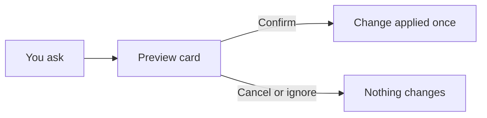

# Commands

For recruiters and managers: every slash command, grouped by what you are trying to do, and which ones change RecruitCRM.

*Last reviewed 06/11/2026.*

83 commands in four plugins. Type `/` in Cowork or a chat to see them, or ask in plain English: every
command is a shortcut for something you can phrase yourself. Add context after a command to narrow it,
for example `/find a candidate that hasn't been contacted this week` or `/funnel Q2`.

**On this page:** [Start and end the day](#start-and-end-the-day) · [Candidates](#candidates) ·
[Jobs and clients](#jobs-and-clients) · [Pipeline and records](#pipeline-and-records) ·
[BD and client visits](#bd-and-client-visits) · [Calls, KPIs and data quality](#calls-kpis-and-data-quality) ·
[Billing and deals](#billing-and-deals) · [Writing content](#writing-content) ·
[Managers and admins](#managers-and-admins) · [Things worth knowing](#things-worth-knowing) ·
[Where they live](#where-they-live)

> [!IMPORTANT]
> **Writes?** **Yes** means the command changes RecruitCRM (or Outlook Drafts, or Slack). Every one
> shows a preview first and applies only when you press Confirm on the card or say yes. **Optional**
> means it reads by default and offers a previewed change at the end. **No** means read-only.

## Start and end the day

| Command | What it does | Writes? |
|---|---|---|
| `/dashboard` | The live dashboard inline: your desk, or firm KPIs and the team for admins. Scoped views in quotes, e.g. `/dashboard "cold jobs"` | No |
| `/kpi` | Headline KPIs only: placements, open jobs, pipeline value, firm totals | No |
| `/myday` | Your standup: interviews to prep for, feedback due, aging offers, stalled candidates, cold roles | Optional |
| `/queue` | Your ranked calls for today (the same list as the 08:30 Slack DM), with the admin for each one drafted for you to check | Optional |
| `/dayplan` | Your day on Octagon's standard structure, with your real priorities slotted in | No |
| `/week` | This week's actuals against the weekly targets for every KPI, with the gap named | No |
| `/eod` | Today's activity on all five weekly KPIs in one table, against where the week needs to be | No |
| `/yesterday` | Yesterday's CV sends, interview requests, interviews, BD calls, client calls and placements, per consultant | No |
| `/dailystats` | Yesterday's CVs sent and interview requests by name: candidate, company, job, current stage, who did it | No |
| `/digest` | Post the morning brief, day end or weekly digest to Slack now, e.g. before a meeting. Cannot be unsent | Yes |

## Candidates

| Command | What it does | Writes? |
|---|---|---|
| `/find` | Find a candidate and every job they are on, with the current stage | No |
| `/candidate` | The full picture on one candidate: work history, education, every job and stage, last call | No |
| `/notes` | Read the notes already recorded against a candidate, job, company or contact | No |
| `/files` | List the files attached to a candidate, job or company | No |
| `/intake` | Fill Octagon's intake template from the candidate's last Devyce AI call summary, with the gaps to ask next time | Optional (save as a note) |
| `/match` | Match candidates to a job or a pasted JD by skills. Off-limit candidates are excluded | No |
| `/silver` | Silver medallists: rejected at 2nd, 3rd or Offered, with open roles to put them forward for | No |
| `/newcandidate` | Add a candidate, typed in or from a CV (attached, or emailed to your connected inbox). Duplicate-checked | Yes |
| `/editcandidate` | Edit a candidate record, with a before/after preview | Yes |
| `/hotlist` | Shared talent pools: list, create, add or remove candidates | Yes (changes only) |
| `/offlimit` | Check, list, mark or release off-limit candidates | Yes (mark/release only) |

## Jobs and clients

| Command | What it does | Writes? |
|---|---|---|
| `/pipeline` | Look up a job and see who is in play, with each candidate's stage | No |
| `/jobstatus` | Roles by status: what is live, on hold, closed or cancelled | No |
| `/newjobs` | New jobs added, and which are missing a completed job order form | No |
| `/coldjobs` | Open roles with no candidate activity in the last 7 days, oldest first | No |
| `/jdcheck` | Open jobs with no Internal JD, or one Claude can't read (broken link, scanned PDF, old .doc) | No |
| `/account` | Per-client activity: CVs sent, interviews, placements and conversion, ranked | No |
| `/newjob` | Create a job, ready for the website | Yes |
| `/editjob` | Close, hold, or change salary, pay type, job type, workplace, categories, title, location, advert or job order form | Yes |
| `/dpe` | Record a job's six DPE scores, Total Score, Job Grade and briefing call date, then draft the DPE email | Yes |
| `/client` | Create or edit a company or a contact | Yes |
| `/pushtell` | Push & Tell: draft the weekly update for each client with A and B grade jobs and stamp the date on each job. Drafts only | Yes |

## Pipeline and records

| Command | What it does | Writes? |
|---|---|---|
| `/chase` | What to chase now across your whole pipeline, in priority order | No |
| `/stalled` | Firm-wide aging offers and stalled candidates on open roles | No |
| `/unbooked` | Interview requests that were never booked in | No |
| `/feedback` | Candidates interviewed with no feedback logged since | No |
| `/rejections` | Why candidates fall out: client rejections versus our own screening | No |
| `/aftercare` | Check-in calls due on your placements (before start, week 1, month 1, month 3), overdue first, with what to ask | No |
| `/move` | Move a candidate to a new hiring stage on a job | Yes |
| `/assign` | Assign a candidate to a job | Yes |
| `/unassign` | Take a candidate off a job, or hide/show them on the client shortlist | Yes |
| `/note` | Add a note to a candidate or a job | Yes |
| `/task` | Set a task or reminder against a client, job or candidate | Yes |
| `/delete` | Permanently delete a record. Irreversible: you type the record's name back to confirm | Yes |

## BD and client visits

| Command | What it does | Writes? |
|---|---|---|
| `/bd` | Yesterday's prospect activity plus the account-status pipeline | No |
| `/lapsed` | Companies we have placed with that have gone quiet (no live job, no new job in 6 months), with a call plan | No |
| `/visits` | Client visits and meetings logged in RecruitCRM | No |
| `/visitplan` | Your visits this quarter against the minimum of 2, which clients and why, then a meeting request and visit brief | Optional (Outlook draft) |
| `/meeting` | Log a client visit or meeting | Yes |
| `/pitch` | Record a speculative pitch to a client contact. Off-limit checked first | Yes |
| `/pitches` | Pitch history: who was pitched to which clients, and what happened | No |

## Calls, KPIs and data quality

| Command | What it does | Writes? |
|---|---|---|
| `/funnel` | The funnel and conversion ratios for any window, firm or per consultant | No |
| `/leaderboard` | Consultants ranked by placements, CV sends or first interviews | No |
| `/timetofill` | Days from job created to first placement, firm and per consultant | No |
| `/noteskpi` | Leads, internal interviews and job order forms logged, by consultant | No |
| `/evening` | Who was on the phone after 17:00, by hour, regardless of call tagging | No |
| `/tagcalls` | Tag your untagged Devyce calls, each with a suggested category, so BD and client calls count | Yes |
| `/hygiene` | The record gaps that make fee, billing, desk and call figures wrong, with the records to fix and how | No |
| `/ref` | RecruitCRM reference data: the valid IDs behind stages, types and statuses | No |

## Billing and deals

| Command | What it does | Writes? |
|---|---|---|
| `/billing` | Quarter-to-date billing against target, pipeline as the forward indicator, and deals by consultant | No |
| `/fees` | The money behind Won deals: total and median fee, fee percentage achieved, by consultant | No |
| `/placements` | Placements with the fee attached | No |
| `/newdeal` | Create a deal: how revenue enters the system | Yes |
| `/won` | Mark a deal Won with its value, annual salary, fee % and start date, or fill those in on a deal already Won | Yes |
| `/claudedeals` | Claude's part in deals: candidates Claude found or put on a job, how far they got, the Won and Offered value behind them, and the admin Claude only recorded, kept separate | No |

## Writing content

Drafts only. Nothing is invented: anything you didn't supply becomes a `[placeholder]`.

| Command | What it does | Writes? |
|---|---|---|
| `/advert` | A job advert from a role in RecruitCRM or a brief you paste | No |
| `/boolean` | A Boolean search string for LinkedIn or the job boards | No |
| `/inmail` | A personalised LinkedIn Recruiter InMail for you to send yourself | No |
| `/specpitch` | A speculative pitch putting a candidate to a client, anonymised by default | No |
| `/interviewprep` | Prep a candidate for an interview: the role, the client, what to expect | No |
| `/formattedcv` | Octagon's coversheet plus a redacted, reformatted CV, as a file to send to a client | No |
| `/email` | Draft or send an email to a candidate or contact. Draft is the default; a sent email cannot be recalled | Yes |

## Managers and admins

These need a manager or admin token; a recruiter token gets a plain refusal. The output is individual
performance and usage data: keep it out of team channels.

| Command | What it does | Who | Writes? |
|---|---|---|---|
| `/exceptions` | The team, exceptions only: off plan, backlog, falling ratios, behind on client visits | Managers and admins | No |
| `/eow` | The end-of-week team email in Dale's format, saved to your Outlook Drafts to edit and send | Managers and admins | Yes |
| `/handover` | Move a consultant's Open and On Hold jobs (and the candidates in play on them) to another owner | Managers and admins | Yes |
| `/team` | One screen on how the team uses the platform: active, adoption, features, habits, onboarding | Admins | No |
| `/usage` | How each person uses the platform: activity, features, changes made, who never started | Admins | No |
| `/adoption` | Weekly active users, share of people with access using it, new starters, drop-offs | Admins | No |
| `/habits` | When and how often each person uses it, and who starts the day with "your day" | Admins | No |
| `/map` | Feature map: which parts each person uses, and what nobody uses | Admins | No |
| `/coach` | Each person's KPI gaps next to features that would help, and changes started but never confirmed | Admins | No |
| `/health` | Is the platform working: sync per feed, scheduled jobs, inboxes, tool errors in the last 7 days | Admins | No |
| `/tokens` | Who holds connector access, and switching a person's access off | Admins | Yes (revoke) |

Several recruiter commands also widen for managers: `/lapsed`, `/hygiene`, `/aftercare`, `/silver` and
`/jdcheck` show your own desk to a recruiter and the firm to a manager or admin unless a name is given.

## Things worth knowing

**Windows default to 2026 year to date**, end date exclusive. Most reporting commands take one:
`/funnel Q2`, `/billing last month`, `/leaderboard July`.

**`/myday` and `/dayplan` scope to your desk.** Pass a name (`/myday Keelan Riley`) to see someone
else's. An admin login with no desk of its own gets the whole team's attention list instead.

**BD and client call counts undercount.** They count only categorised Devyce calls. `/tagcalls` fixes
your own in a minute; read [Data Caveats](Data-Caveats#call-categorisation) before drawing anything from
`/week`, `/eod` or `/bd`.

**The 08:30 Slack DM and `/queue` are the same list.** Each item in the DM has a Done button that
previews the note it will log and writes it only when you confirm. The drafts (prep notes, chase and
booking emails, Booleans, InMails) come from `/queue` in your own Claude.

**Closing a role or losing a deal asks why.** `/editjob` and `/won` offer a reason list when a job
goes to closed, cancelled or on hold, or a deal to Lost or Declined. Optional, but it is the only way
"why do we lose" becomes answerable.

**Outward-facing commands.** `/digest` posts into a Slack channel other people read. `/email` cannot be
recalled and never goes to someone who has opted out. `/pushtell`, `/eow` and `/visitplan` only ever
save drafts.

> [!CAUTION]
> `/delete` is permanent. There is no undo and no restore.

## Where they live

The commands are skills in the [octagon-plugins](https://github.com/ollielarkins/octagon-plugins) repo,
not in this one. Each is `plugins/<plugin>/skills/<command>/SKILL.md`.

| Plugin | Version | Commands |
|---|---|---|
| `octagon-reporting` | 0.2.17 | 47: numbers, pipeline, candidates, content, your day |
| `octagon-actions` | 0.2.14 | 24: everything that changes RecruitCRM, plus `/digest` and `/formattedcv` |
| `octagon-admin` | 0.2.2 | 10: managers and admins |
| `octagon-dashboard` | 0.5.0 | 2: `/dashboard`, `/kpi` |

`plugins/octagon-analytics/` in this repo holds a pointer only. Two copies of a command drift, and the
one that gets edited is never the one that ships.

**Related:** [Tools Reference](Tools-Reference) · [Onboarding](Onboarding) · [Metrics and Definitions](Metrics-and-Definitions) · [Data Caveats](Data-Caveats)
