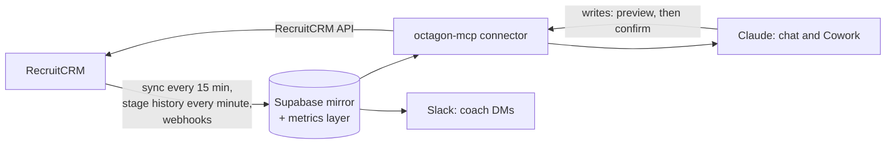

# Octagon Analytics

The landing page for everyone at Octagon: what the platform is, where to go for what, and what has
changed recently.

*Last reviewed 06/11/2026.*

Live recruitment analytics on top of RecruitCRM, with a Claude interface recruiters use directly to
ask questions and take defined actions. RecruitCRM stays the system of record. The platform mirrors
it into Supabase, defines every metric once, and serves those definitions to Claude, Slack and the
inline dashboard, so they never disagree.

---

## I want to...

| | Go to |
|---|---|
| Get set up and connected | [Onboarding](Onboarding) |
| See every slash command | [Commands](Commands) |
| Know what I can ask it | [Tools Reference](Tools-Reference) |
| Use my inbox from Claude | [Inbox](Inbox) |
| Understand what a number counts | [Metrics and Definitions](Metrics-and-Definitions) |
| Check whether a number can be trusted | [Data Caveats](Data-Caveats) |
| Work out why something looks wrong | [Data Caveats](Data-Caveats), then [Operations Runbook](Operations-Runbook) |
| Deploy, backfill, or mint a token | [Operations Runbook](Operations-Runbook) |
| Understand how the data flows | [Architecture](Architecture) |

## The pages

| Page | For |
|---|---|
| **[Onboarding](Onboarding)** | Getting connected and through your first week. Start here if you're a recruiter. |
| **[Commands](Commands)** | All 82 slash commands, grouped by what you are trying to do. |
| **[Tools Reference](Tools-Reference)** | Every question the system can answer, and how to ask it. |
| **[Inbox](Inbox)** | Reading your Outlook inbox from Claude and drafting replies. |
| **[Metrics and Definitions](Metrics-and-Definitions)** | What each number actually means. Read before quoting anything. |
| **[Data Caveats](Data-Caveats)** | Where the numbers are soft, and why. Read this second. |
| **[Architecture](Architecture)** | How data gets from RecruitCRM to your screen. |
| **[Operations Runbook](Operations-Runbook)** | Deploys, backfills, tokens, incidents. Admins only. |

---

## What's new since 15/09/2026

**Your day and coaching**
- **The Octagon Coach** (a separate Slack app): DMs at 12:30, 16:45 and Monday 08:45 with named
  suggestions, Done and Snooze buttons, one-press call tagging at 16:45 and an Away date. Monday names
  your biggest offers; Friday compares the week with the last. Still in shadow mode: previews go to
  Oliver only.
- **The action queue**: `/queue` or "prep my queue" ranks today's calls and drafts the admin for
  each one.
- **"Your day"** now suggests one command picked from your own data.

**Finding work**
- `/silver` (rejected at 2nd, 3rd or Offered, with open roles to put them forward for), `/lapsed`
  (past clients gone quiet, with a call plan), `/aftercare` (check-in calls due on placements),
  `/dailystats` (yesterday's CVs and interview requests by name).
- `/claudedeals`: what Claude has contributed to deals, with candidates it found or put on a job kept
  apart from stage moves it only recorded. `/match` now logs its suggestions, so a CV sent from them
  counts even when the candidate was added in RecruitCRM.

**Keeping the data right**
- `/hygiene` lists the gaps that make fee, billing, desk and call figures wrong. `/won` now sets
  salary, fee % and start date, including on deals already Won.
- `/jdcheck` for recruiters: which open jobs have no Internal JD, or one Claude can't read.
- **Contacts are mirrored** (18,399, without email or phone), so lookups and call suggestions work
  against every client contact.

**Admin and safety**
- `/handover` moves a consultant's Open and On Hold jobs to someone else (admins and managers).
- Security: the public dashboard pages are retired, confirms need a real preview, deletes need the
  record's name typed back, off-limit is checked on every path to a client, leavers' access is
  revoked automatically, and sign-in only redirects back to Claude's own callback address.

The full history is in
[`docs/DECISIONS.md`](https://github.com/ollielarkins/octagonanalytics-reverse/blob/main/docs/DECISIONS.md)
and the commit log.

> [!CAUTION]
> **BD and client call KPIs count only tagged Devyce calls.** About 12% of calls were tagged in
> October 2026. `/week`, `/eod` and the coach now show, beside the tagged count, how many untagged
> calls look like BD or client calls (from how the contact was tagged before, the company's status,
> or a job there in the last 18 months). Those are never added to the KPI. `/tagcalls` turns them into
> real counts. See [Data Caveats](Data-Caveats#call-categorisation).

## The platform at a glance (04/11/2026)

| | |
|---|---|
| Connector | octagon-mcp 3.101.0, 80 tools and 26 prompts |
| Commands | 82, in four plugins: octagon-reporting 0.2.18, octagon-actions 0.2.15, octagon-dashboard 0.5.0, octagon-admin 0.2.2 |
| Database | Supabase Postgres 17, 158 migrations, 25 scheduled jobs watched by a cron manifest |
| Slack | Coach DMs 12:30 and 16:45 weekdays, Monday 08:45 (shadow) |
| Access | 19 active tokens held by 10 people |

| Mirrored from RecruitCRM | Records |
|---|---|
| Notes | 101,748 |
| Candidates | 53,235 |
| Candidate stage events (the funnel feed) | 46,917 |
| Contacts | 18,399 |
| Devyce calls (from 13/03/2026) | 16,955 |
| Jobs | 6,083 (141 open) |
| Clients | 4,833 |
| Deals | 1,712 |
| Meetings | 286 |

---

## Ground rules

1. **RecruitCRM is the system of record.** Writes go there, through the connector, never through the
   RecruitCRM website in a browser. The mirror catches up via the normal sync. Never edit the mirror
   to "fix" a number.
2. **One definition per metric.** If a figure appears in two places it comes from the same view or
   RPC. Never write ad-hoc logic against the raw tables.
3. **Every write is previewed first** and applied only on an explicit confirm.
4. **Candidate names are PII.** Internal only. Not client-facing unless already shared with that
   client. No bulk export.
5. **Never invent a number.** If the data can't answer, say so.

**Related:** [Onboarding](Onboarding) · [Commands](Commands) · [Data Caveats](Data-Caveats) · [Architecture](Architecture)
