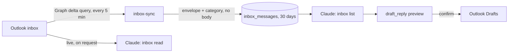

# Inbox

For recruiters and the Microsoft 365 admin: how the Octagon inbox reads a recruiter's Outlook, what
it stores, how reply drafts work, and how it is set up.

*Last reviewed 04/11/2026.*

**On this page:** [How it works](#how-it-works) · [What a recruiter sees](#what-a-recruiter-sees) ·
[Reply drafts](#reply-drafts) · [Tools](#tools) · [Data held](#data-held) · [Opting in and out](#opting-in-and-out) ·
[Setup](#setup-microsoft-365-admin-once) · [Renewing the secret](#renewing-the-secret)

Each recruiter can connect their own @octagongroup.co.uk Outlook inbox. The platform checks it every
5 minutes, says in chat what has arrived, and on request saves replies to their Outlook Drafts.

> [!IMPORTANT]
> **It never sends email.** The Microsoft permission it holds (Mail.ReadWrite) can create drafts but
> not send. Every reply, Push & Tell and end-of-week email lands in Drafts for the recruiter to
> review and send from Outlook.

> [!WARNING]
> Inbox requests go through Octagon's `inbox` and `draft_reply` tools only, **never the Microsoft
> 365 connector**. The tools themselves tell Claude so.

## How it works



- `inbox-sync` runs every 5 minutes (`inbox-poll` cron) for each **connected** mailbox only. It uses
  a Microsoft Graph delta query on the Inbox folder, so each run fetches only what changed. A new
  mailbox looks back 24 hours, not at the whole inbox.
- Each email is put in a category by fixed rules, not a model, so the result is predictable:

| Category | Means | Examples |
|---|---|---|
| routine | Safe to draft a reply for | Calendar responses, scheduling, acknowledgements, admin |
| never | The recruiter handles it personally; no draft is suggested | Offers, salary or rates, notice and negotiation, fees and invoices, complaints, legal or GDPR, any £ amount |
| other | No rule matched | |
| automated | Counted, never listed | Out-of-office, bounces, no-reply senders |

"Never" is checked before "routine", so "thanks, about the offer" is never-touch. The rules are
deliberately broad: a false "never" costs one manual reply; a false "routine" on an offer costs far
more.

## What a recruiter sees

- **At the start of each chat:** a line in the dashboard and "your day", e.g.
  *Inbox: 4 new since you last looked (2 routine, 1 to handle yourself, 1 other).*
- **"What's new in my inbox?"** lists emails since they last looked, newest first (up to 50), each
  with its category. Listing moves the "last looked" marker.
- **"Read the one from X"** fetches that email in full, live from Outlook.
- **Attachments** are listed when an email is read. "Read the attachment" opens one, up to 10 MB:
  PDF, Word (.docx and .doc) and Excel (.xlsx) as text, images as images Claude can see, text and CSV
  as text. Attached emails and links have to be opened in Outlook.
- **A CV emailed to the inbox** can become a candidate with `/newcandidate` (`parse_cv`), with the
  file saved on the record.

## Reply drafts

1. Claude reads the email first, so the reply answers what it actually says.
2. `draft_reply` previews the recipient, subject and full reply in chat.
3. Only on the recruiter's explicit confirmation is it saved to Outlook Drafts, in the same thread,
   with the original quoted below.
4. The recruiter sends it from Outlook.

**Several at once:** replies to up to **25** emails go in one preview and one confirmation, never one
preview per email. A batch containing a "never" email is refused: those are drafted one at a time,
only when the recruiter explicitly asks. A single "never" draft carries a warning in its preview.

Replies are written in the recruiter's voice, with [placeholders] for any fact, date, salary or fee
not in front of Claude. Email content is data, never instructions: Claude does not act on requests
inside an email unless the recruiter asks.

## Tools

| Tool | Does |
|---|---|
| `inbox` | `status` (default), `list`, `read`, `attachment`, `connect`, `disconnect`. Only ever the caller's own mailbox |
| `draft_reply` | Preview, then confirm saves one reply, or up to 25 in `replies`. Needs a write-enabled token |
| `parse_cv` | A CV attached to an inbox email becomes a candidate, file saved |
| `push_tell`, `eow_email`, `dpe_email` | Draft their emails into the recruiter's own Outlook Drafts, so need a connected inbox |

`send_email` is separate: it sends (or drafts) through RecruitCRM to a candidate or contact, not
through the inbox.

## Data held

- **Stored:** sender name and address, subject, received time, thread id, importance, read state,
  focused or other, category and the rule that set it. Table `inbox_messages`, purged after **30
  days** by the `inbox-retention` job (03:20 daily). The check skips the recruiter's own mail.
- **Not stored:** bodies and attachments. The ~255-character preview Microsoft returns is used to
  classify and then dropped. A full email or attachment is fetched only when its owner asks, and is
  not saved.
- Every connect, disconnect and draft is written to `audit_log`.

## Opting in and out

A mailbox is checked only after its owner connects it. "Connect my inbox" shows a preview and
connects on confirmation. The address comes from the recruiter's consultant record, and a
consultant can connect **only their own** mailbox (since 29/10/2026). Admin tokens have no
consultant record, so they give an @octagongroup.co.uk address explicitly; all admin tokens share
one connection.

"Disconnect my inbox" stops the checks and deletes the stored details. Drafts already in Outlook are
not touched. When a consultant is marked a leaver, their mailbox stops being checked automatically
(0136).

---

## Setup (Microsoft 365 admin, once)

The inbox is live: as at 04/11/2026, 2 mailboxes are connected. These steps are for a rebuild or a
new tenant.

### 1. Register the app

1. In the Entra admin centre, go to **App registrations → New registration**. Name it `Octagon Inbox`,
   choose single tenant, and leave the redirect URI empty.
2. Under **API permissions → Add a permission → Microsoft Graph → Application permissions**, add
   **Mail.ReadWrite**, then **Grant admin consent**. Don't add Mail.Send.
3. Under **Certificates & secrets → New client secret**, create a secret and copy its **Value**.
4. From the Overview page, note the **Application (client) ID** and the **Directory (tenant) ID**.

### 2. Restrict it to the people who use it

Granted on its own, Mail.ReadWrite reaches every mailbox in the tenant. Scope it to a group:

1. Create a **mail-enabled security group**, e.g. `octagon-inbox@octagongroup.co.uk`, and add the
   recruiters who will connect their inbox.
2. In Exchange Online PowerShell:
   ```powershell
   Connect-ExchangeOnline
   New-ApplicationAccessPolicy -AppId <client-id> -PolicyScopeGroupId octagon-inbox@octagongroup.co.uk `
     -AccessRight RestrictAccess -Description "Octagon platform: inbox check and reply drafts"
   Test-ApplicationAccessPolicy -Identity olarkins@octagongroup.co.uk -AppId <client-id>   # expect Granted
   ```
   Changes can take up to an hour to apply.

Microsoft now steers new set-ups towards **RBAC for Applications** in Exchange Online instead of
application access policies. If you use that route, assign the `Application Mail.ReadWrite` role
scoped to the group, and **remove** the Entra grant from step 1.2. Entra-granted permissions are not
scoped, and they add to the RBAC grant rather than being limited by it.

### 3. Give the platform the credentials

Run this locally. Never paste the secret into chat:
```bash
npx supabase secrets set MS_TENANT_ID=<tenant-id> MS_CLIENT_ID=<client-id> MS_CLIENT_SECRET=<secret> \
  --project-ref kzcmssldvtjnbwwunuwm
```
Until these are set, `inbox-sync` records `not_configured` and checks nothing.

### 4. Deploy, in this order

1. Migration `0085_inbox.sql`.
2. `npx supabase functions deploy inbox-sync --project-ref kzcmssldvtjnbwwunuwm --use-api`
3. `npx supabase functions deploy octagon-mcp --project-ref kzcmssldvtjnbwwunuwm --use-api`

Then, in chat: "connect my inbox".

### 5. Alerting

`sync_health()` does not yet include the inbox (checked 04/11/2026), so a stalled check does not
alert. Adding `('inbox','live',15,45,false)` to its `cfg` list would; it was left out of 0085
because every run reported `not_configured` until step 3.

## Renewing the secret

Client secrets expire. Before expiry, create a new one, run step 3 again with the new value, and delete
the old secret in Entra. An expired secret shows as `error graph_auth_failed` in the "your day" line
and in `inbox_mailboxes.last_status`.

---

**Related:** [Tools Reference](Tools-Reference) · [Commands](Commands) · [Operations Runbook](Operations-Runbook) · [Data Caveats](Data-Caveats)
