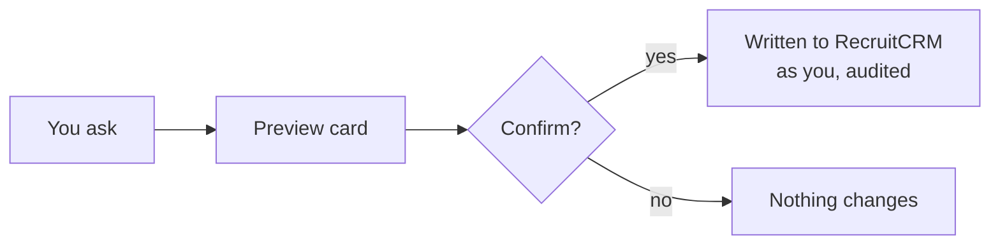

# Onboarding

For a recruiter starting on Octagon Analytics: how to connect, what to learn in your first week, and
the rules that keep RecruitCRM and candidates safe.

*Last reviewed 04/11/2026.*

**On this page:** [Get connected](#get-connected) · [Before you trust a number](#before-you-trust-a-number) ·
[Your first week](#your-first-week) · [What arrives in Slack](#what-arrives-in-slack) ·
[Making changes](#making-changes) · [Never do this](#never-do-this) ·
[Something not working?](#something-not-working)

---

## Get connected

About fifteen minutes, once.

### 1. Get your access token

Ask Ollie to mint you one. It maps to **you**: your figures are scoped to your desk, and anything you
change in RecruitCRM is attributed to your name, not a shared account. Treat it like a password: never
paste it into a chat, ticket or shared doc.

Three things are set on your token when it is created:

| Setting | What it controls |
|---|---|
| Write access | Whether you can change anything in RecruitCRM at all |
| Admin | Whether you see the whole team or just your own desk. Recruiters see their own |
| Usage viewer | Whether you can see team usage views without full admin |

### 2. Add the connector

The connector may already be set up for the whole organisation; if so, just enable it and sign in.
Otherwise, in claude.ai (web or desktop):

1. Settings → Connectors → Add custom connector
2. Name: `Octagon Analytics`
3. URL: `https://kzcmssldvtjnbwwunuwm.supabase.co/functions/v1/octagon-mcp`
4. Connect. Claude opens Octagon's **Connect your account** page. Paste your token and press
   **Authorize**. You are sent straight back to Claude.

If the page says the token wasn't recognised, check you pasted all of it, or ask Ollie for a new one.

### 3. The plugins arrive on their own

The slash commands come from four Octagon plugins, published org-wide, so there is nothing to install.

| Plugin | Who gets it |
|---|---|
| octagon-reporting | Everyone. Read-only reporting, lookup, writing aids and your day |
| octagon-dashboard | Everyone. The inline dashboard and `/kpi` |
| octagon-actions | Only people who should write to RecruitCRM |
| octagon-admin | Managers and admins |

### 4. Turn auto mode on (Cowork)

In Cowork, switch **auto mode** on. Without it you approve every step individually, which turns a
ten-second answer into a dozen clicks. Writes still stop for your confirmation either way.

### 5. Check it worked

Start a new chat and say **dashboard**. You should see **Your desk** with your name and your own
numbers. If you see a whole-team view instead, your token is resolving as an admin: tell Ollie.

| What you see | What it means |
|---|---|
| An authentication error | Token wrong or revoked. Ask Ollie for a new one |
| Nothing happens | The connector isn't enabled in that chat |
| A command you expected is missing | A connector release added it: reconnect, or start a new chat |

> [!NOTE]
> Admins can see how each person uses the platform: which features, how often, and what kind of
> change was made (for example "3 stage moves"). Not which candidate, and not what you wrote. Chats
> that don't use the connector aren't counted. It exists to help people get set up, not to measure
> performance.

---

## Before you trust a number

Three things look broken on day one and aren't.

- **BD and client call counts look low.** They count only Devyce calls that have been tagged with a
  category, and most calls aren't (about 12% in October 2026). `/week`, `/eod` and the coach show,
  next to the tagged count, how many untagged calls look like BD or client calls. Those don't count
  until tagged: `/tagcalls` fixes it in a few clicks.
- **Monday morning reads 0.** The KPI week runs Monday to Sunday. A fresh week genuinely is 0 of 10
  CV sends. Early-week gaps are expected.
- **Shortlist looks thin.** Only some of the desk use that stage, so it isn't the top of your funnel.
  The funnel is CV Sent → Interview Request → 1st → 2nd → 3rd → Offered → Placed.

The weekly minimums are 10 CV sends, 5 interview requests, 4 interviews, 5 BD calls and 5 client
calls. Full list of soft spots on [Data Caveats](Data-Caveats).

---

## Your first week

### The five commands to learn first

| Command | When | What you get |
|---|---|---|
| `/myday` | First thing | Interviews to prep, feedback due, aging offers, stalled candidates, cold roles, plus one command worth trying today |
| `/queue` | Morning | Today's ranked calls, with the admin for each drafted for you to check |
| `/chase` | Mid-morning | What to chase across your whole pipeline, in priority order |
| `/week` | Any time | This week against every KPI target, with the gap named |
| `/eod` | End of day | Today on all five KPIs in one table, against where the week needs to be |

You don't need command syntax: "what's my day?", "how am I doing this week?" and "prep my queue" work
just as well. Type `/` to see the rest, or read [Commands](Commands).

### A practical week

| Day | Do this |
|---|---|
| Monday | Connect. Say **dashboard**, then `/myday`. Run `/tagcalls` on last week's calls so your BD and client numbers are real |
| Tuesday | Start from `/queue` and work the list |
| Wednesday | Pick a live role: `/pipeline` for who's in play, `/coldjobs` for roles with no activity in 7 days, `/silver` for interview-tested candidates to put forward |
| Thursday | Content on a real role: `/advert`, `/boolean`, `/match`. Missing details come back as `[placeholders]`, never invented |
| Friday | `/week` to see the gap, `/eod` before you finish. If you have write access, `/pushtell` drafts your client updates |

---

## What arrives in Slack

| Message | When | Who gets it | What to do |
|---|---|---|---|
| Coach DMs | 12:30, 16:45, Monday 08:45 | Shadow mode: Oliver only for now | Named suggestions with Done and Snooze; at 16:45, one-press tagging of today's calls |

---

## Making changes

Only with write access and the octagon-actions plugin.

Every change is **two-step**. You ask; Claude shows a preview card with exactly what will change (for
a stage move: the candidate, the job, current stage and new stage); you press **Confirm** or say yes;
only then does it touch RecruitCRM. The change is attributed to you, written to the audit log, and
the mirror refreshes so your figures are right straight away.

- **One preview, one confirm.** A confirm only works for the preview it came from, and covers at most
  25 records.
- **Closing a job or losing a deal asks why.** Pick a reason or skip it, but it is the only way "why
  do we lose" becomes answerable.
- **Moving to Placed** needs the candidate's start date.
- **Deletes are permanent.** No undo. You type the record's name back to confirm.
- **Email can't be recalled.** Drafting is the default and drafts go to your Outlook Drafts. It
  checks opt-out first. Replies from your [Inbox](Inbox), Push & Tell and the end-of-week email are
  always drafts.

---

## Never do this

> [!WARNING]
> - **No bulk export.** Candidate names and notes are PII: internal only, never pasted into a client
>   email unless already shared with that client.
> - **Never through the RecruitCRM website.** Changes go through the connector. If no command can make
>   a change, Claude says so and gives you the manual step; don't ask it to open RecruitCRM in a
>   browser.
> - **Drafts, not sends.** Read every email, InMail and pitch before it leaves you. Spec pitches stay
>   anonymised until the client engages, and off-limit candidates are never pitched or emailed.

**It will tell you when it can't answer.** "That isn't tracked" is the system working, not failing.
Leads, internal interviews and job order forms are note types (`/noteskpi`), pitches are RecruitCRM's
pitch feature (`/pitches`), and client visits are meetings (`/visits`): they all count only what was
logged. Ask "where does that number come from?" to get the definition.

---

## Something not working?

Post in #troubleshooting, or message Ollie, with what you asked, what you expected and what you got.
Screenshots help. The **Report an issue** link on the connect page reaches Ollie too.

**Related:** [Commands](Commands) · [Data Caveats](Data-Caveats) · [Metrics and Definitions](Metrics-and-Definitions) · [Inbox](Inbox)
