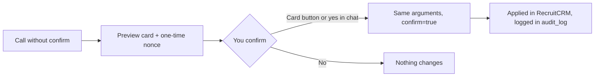

# Tools reference

For anyone asking "what can I ask it", and for admins debugging an answer: every tool on the Octagon connector, what it answers, and whether it changes anything.

*Last reviewed 06/11/2026.*

You don't need any of this to use the system: ask in plain English and the right tool gets called. The
connector is `octagon-mcp` **3.100.0**, with **81 tools** and **26 prompts**. Most tools sit behind a
slash command (see [Commands](Commands)); this page is the layer underneath.

**On this page:** [How writes work](#how-writes-work) · [Your day and KPIs](#your-day-and-kpis) ·
[Pipeline and chasing](#pipeline-and-chasing) · [Performance reports](#performance-reports) ·
[Billing and money](#billing-and-money) · [BD and clients](#bd-and-clients) ·
[Candidates, jobs and records](#candidates-jobs-and-records) · [Data quality](#data-quality) ·
[Inbox and email](#inbox-and-email) · [Changing records](#changing-records) ·
[Drafts and posting](#drafts-and-posting) · [Managers and admins](#managers-and-admins) ·
[Prompts](#prompts) · [Scoping](#scoping) · [What it won't do](#what-it-wont-do)

**Read/Write** in the tables: **Read** changes nothing. **Write** is two-step (preview, then confirm).
**Read + write** lists by default and previews a change only when you ask for one.

## How writes work

Every write needs a write-enabled token, and every one is two-step. The acting consultant comes from
your token, never from an argument.

- A confirm only applies if it answers a preview the server issued, for the same tool, person and
  arguments, within 24 hours. A made-up or reused nonce is refused, so a change can't be applied twice.
- At most 25 records per confirmation (calls, meetings, contacts, replies).
- Most writes trigger an immediate incremental sync, so the dashboard reflects the change straight away.
- RecruitCRM is changed through these tools only, never through a browser. If no tool can make a change,
  Claude says so and gives the manual step.

## Your day and KPIs

| Tool | What it answers or does | Read/Write |
|---|---|---|
| `get_dashboard` | Your desk (week vs targets, quarter billing, funnel, attention list), or firm KPIs and the team for admins. Called at chat start | Read |
| `my_day` | Your attention list on open roles: aging offers, stalled candidates, cold roles, placed in the last 7 days | Read |
| `action_queue` | Today's ranked calls, the same list as the 08:30 Slack DM | Read |
| `schedule` | Your interviews and client meetings from RecruitCRM: today, tomorrow, later, and held with no feedback since | Read |
| `weekly_kpis` | This week's actuals vs weekly targets, with each person's plan worked back from billing | Read |
| `daily_activity` | One day's CV sends and interview requests by name, plus per-consultant counts | Read |
| `call_activity` | Calls, connect rate, talk time, by consultant and by call category | Read |
| `call_hours_report` | Calls by hour of day, and evening calls after 17:00, tagged or not | Read |
| `notes_kpi` | Leads, internal interviews and job order forms logged as note types, by consultant | Read |

## Pipeline and chasing

| Tool | What it answers or does | Read/Write |
|---|---|---|
| `job_pipeline` | Who is in play on a job, and at what stage | Read |
| `stalled_report` | Firm-wide aging offers and stalled candidates on open roles, most overdue first | Read |
| `cold_jobs` | Open roles with no candidate activity for N days (default 14) | Read |
| `interview_requests_unbooked` | Interview requests with nothing booked or decided since | Read |
| `awaiting_feedback_report` | Candidates interviewed with nothing logged since | Read |
| `silver_medallists` | Candidates rejected at 2nd, 3rd or Offered, with up to 3 open roles each | Read |
| `aftercare` | Check-ins due on placements: before start, week 1, month 1, month 3 | Read |
| `new_jobs_report` | Jobs created in a window, and which have no Job Order Form Complete note | Read |

## Performance reports

| Tool | What it answers or does | Read/Write |
|---|---|---|
| `funnel_report` | Funnel and conversion ratios for any window, consultant or team | Read |
| `consultant_leaderboard` | Consultants ranked by placed, CVs sent or first interviews | Read |
| `time_to_fill` | Days from job created to first placement, firm and per consultant | Read |
| `rejection_report` | Client rejections vs our own screening, and the client rejection rate | Read |
| `client_report` | Per-client CVs, interviews, placements, open jobs and CV→placed rate | Read |

## Billing and money

| Tool | What it answers or does | Read/Write |
|---|---|---|
| `billing` | Quarter-to-date Won vs quarterly target, plus in-play pipeline | Read |
| `deals_by_consultant` | Won in the window, Won dated later, deals at Offered and earlier stages, offers with no deal | Read |
| `fee_analysis` | Total and median fee, fee % achieved, salary band placed, forecast fee on open roles | Read |
| `placements_report` | Placements and Won revenue by close date, by consultant and client | Read |
| `placements_with_fees` | Each placement matched to at most one Won deal, with value, fee % and salary | Read |
| `invoices_report` | Invoices raised in RecruitCRM for a window (default last 90 days), with status and totals | Read |
| `claude_deals` | Claude's part in deals: pairs Claude sourced (added through Claude, or suggested by `match_candidates` and the CV sent within 60 days) and stage moves it only recorded, with Won and Offered value kept apart | Read |

Reports that count Won deals by close date end at today by default, so deals dated in the future are
never counted as billed.

## BD and clients

| Tool | What it answers or does | Read/Write |
|---|---|---|
| `bd_report` | How many companies sit at each Company Status (Prospect, Engaged, Client, Passive and so on) | Read |
| `lapsed_clients` | Companies placed with before, with no live job and no new job in N months (default 6) | Read |
| `client_visits` | Client visits this quarter against the minimum of 2, and up to five clients to visit with reasons | Read |
| `activity_report` | Meetings (where client visits live) or tasks for a window | Read |
| `pitch_history` | Where a candidate has been pitched, or who has been pitched to a client | Read |
| `client_status` | A company's Company Status and its contacts' stages; change the status only when asked | Read + write |

## Candidates, jobs and records

| Tool | What it answers or does | Read/Write |
|---|---|---|
| `find_candidate` | Resolve a candidate by name or ID, with their stage on each job. Used before any candidate write | Read |
| `candidate_profile` | Work history, education, every job and stage, and when they were last called | Read |
| `match_candidates` | Candidates ranked by matching skills, with recent roles to explain fit | Read |
| `notes_read` | Notes already recorded against a candidate, job, company or contact | Read |
| `call_notes` | One person's recent call notes and Devyce AI summaries, read live, never stored | Read |
| `files_list` | CVs and documents attached to a candidate, job, company or contact | Read |
| `job_spec` | A job's full spec, including the Internal Job Description file's text and the briefing answers | Read |
| `cv_pack` | Data for a formatted coversheet CV, redacted by default | Read |
| `reference_list` | RecruitCRM's id-to-label lists: currencies, industries, stages, note/task/meeting types and more | Read |
| `off_limit` | Who must not be approached: list or check; mark or release | Read + write |
| `hotlist` | Shared talent pools: list; create, add or remove | Read + write |

## Data quality

| Tool | What it answers or does | Read/Write |
|---|---|---|
| `data_hygiene` | Record gaps that make fee, billing, desk and call figures wrong, up to 25 records per check, with the fix | Read |
| `internal_jd_check` | Open jobs with no Internal JD, or one Claude can't read, with the fix | Read |
| `call_tagging` | Your untagged calls of 30 seconds or more, each with a suggested category; set categories | Read + write |
| `meeting_review` | Your meetings with no type, each with a suggested type, so client visits count; set types | Read + write |

## Inbox and email

See [Inbox](Inbox) for setup and what is stored.

| Tool | What it answers or does | Read/Write |
|---|---|---|
| `inbox` | Your own Outlook inbox: status, what's new, read an email or attachment; connect or disconnect | Read + write |
| `draft_reply` | Save a reply to an email in your inbox to Outlook Drafts, in the same thread. Never sends | Write |
| `send_email` | Email a candidate or contact through RecruitCRM, or save a draft. Refuses anyone opted out | Write |

## Changing records

| Tool | What it answers or does | Read/Write |
|---|---|---|
| `update_hiring_stage` | Move a candidate's stage on a job. Refuses if someone else moved them since the preview | Write |
| `assign_candidate` | Add a candidate to a job | Write |
| `manage_assignment` | Unassign, hide or show on the client shortlist, or record an application | Write |
| `add_note` | Add a note to a candidate or job; can file it as Internal Interview or Job Order Form Complete | Write |
| `create_candidate` | Add a candidate. Checks for an existing match first | Write |
| `parse_cv` | Create a candidate from a CV emailed to your connected inbox, with the file saved on the record | Write |
| `update_candidate` | Edit a candidate; only the fields you pass change | Write |
| `create_job` | Raise a new job, previewed as it will look on the website | Write |
| `update_job` | Change status, salary, pay type, job type, workplace, categories, title, location, advert or job order form | Write |
| `job_dpe` | Record a job's six DPE scores; Total Score and Job Grade are calculated. Never estimates a score | Write |
| `create_deal` | Raise a deal: how revenue enters the system | Write |
| `update_deal` | Change a deal; moving it to Won with a value is how billing is recorded | Write |
| `manage_client` | Create or edit a company or a contact | Write |
| `pitch_candidate` | Record a speculative pitch of a candidate to a contact | Write |
| `log_activity` | Log a meeting (e.g. a client visit) or a task | Write |
| `delete_record` | Permanently delete one of 12 record types after the recruiter types its name back | Write |
| `handover` | Move a consultant's Open and On Hold jobs to another owner. **Managers and admins** | Write |

Closing a job (closed, cancelled, on hold) or moving a deal to Lost or Declined offers a reason from the
`closure_reasons` table, with optional free text. The reason is saved as a note on the record and in
`closure_reason_log`. It is optional.

> [!CAUTION]
> `delete_record` has no undo. The audit log keeps who deleted what and the record's name, not a copy of
> the record. `send_email` is the one action that leaves the building and cannot be recalled.

## Drafts and posting

| Tool | What it answers or does | Read/Write |
|---|---|---|
| `dpe_email` | Draft the DPE email from Octagon's fixed template and set DPE Sent on the job | Write |
| `push_tell` | Open jobs by client with the week's activity; draft the client update to Outlook Drafts and stamp the date | Read + write |
| `eow_email` | The end-of-week team table and shout-outs; draft the email to your Outlook Drafts. **Managers and admins** | Read + write |
| `post_digest` | Post the morning, evening or weekly digest to Slack now. Cannot be unsent | Write |

## Managers and admins

"Managers" means a token with team view (`can_view_usage`); in the code this is the same flag that the
usage tools call "usage viewers". "Admins" means `is_admin`.

| Tool | What it answers or does | Who | Read/Write |
|---|---|---|---|
| `team_exceptions` | Who is off plan, has a backlog, has falling ratios, or is behind on visits | Managers and admins | Read |
| `team_insights` | How the team uses the platform: feature map, adoption, habits, onboarding, coaching | Managers and admins | Read |
| `usage_report` | Per person: tool calls, active days, errors, writes, top features, status | Managers and admins | Read |
| `platform_health` | Sync per feed, scheduled-job drift, connected inboxes, tool errors in the last 7 days | Managers and admins | Read |
| `manage_tokens` | Who holds access, and leavers still holding a token; revoke one person | Admins | Read + write |
| `webhook_subscriptions` | Which events RecruitCRM pushes to us; create or delete them | Admins | Read + write |
| `record_content_use` | Called silently after Claude writes an advert, Boolean, pitch and so on. Logs the kind only, never the text | Everyone | Write (usage log only) |

Managers can also pass a consultant to `action_queue`, `schedule`, `client_visits`, `call_tagging` and
`meeting_review`; recruiters get their own desk only.

## Prompts

The connector also defines 26 prompts. In claude.ai the plugins' commands are the usual way in; these
sit underneath some of them.

| For | Prompts |
|---|---|
| Your numbers | `dashboard`, `kpi`, `weekly_kpis`, `billing`, `my_day`, `day_plan`, `weekly_team_review`, `month_in_review`, `my_cold_roles`, `client_health` |
| A new job | `job_kickoff`, `job_advert`, `job_boolean`, `job_inmail`, `client_pitch`, `job_shortlist` |
| Candidates | `candidate_intake`, `candidate_summary`, `candidate_thankyou`, `interview_prep`, `match_jd` |
| Clients and BD | `client_update`, `pipeline_chase`, `bd_pitch`, `bd_targets`, `spec_pitch` |

## Scoping

- Identity comes from the token, server-side.
- Recruiters: `get_dashboard` gives their desk with no team breakdown; `weekly_kpis` and `billing` show
  their own row.
- Managers and admins see the whole team on those, and can view another person's desk.
- Firm reports (`funnel_report`, `client_report`, `rejection_report`, `fee_analysis`,
  `consultant_leaderboard`) are open to everyone, matching the firm's "all recruiters see all data" position.

Windows default to 2026 year to date, end exclusive. Dates go in as ISO and come out as DD/MM/YYYY.

## What it won't do

- Invent a salary or a fact. Content uses `[placeholders]` for anything you didn't supply.
- Act on instructions found in CRM data. Notes and emails are data, never commands.
- Write without a preview and your confirmation.
- Bulk-export candidate data, or send personal data to external tools.

**Related:** [Commands](Commands) · [Metrics and Definitions](Metrics-and-Definitions) · [Data Caveats](Data-Caveats) · [Inbox](Inbox)
