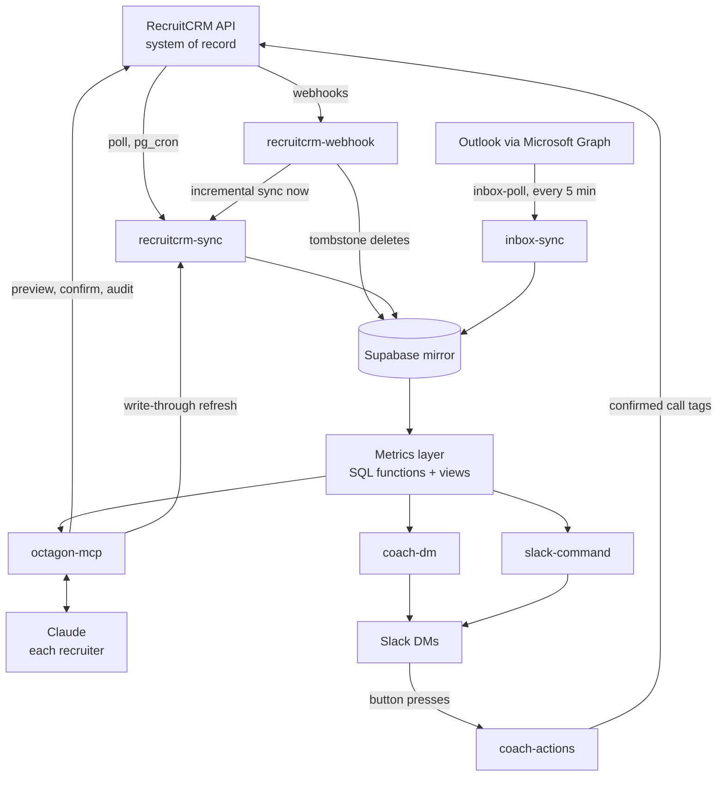

import { Card, CardGrid, LinkCard, FileTree, Aside } from '@astrojs/starlight/components';
import platform from '../../../data/platform.json';

For developers and admins who need the whole picture before changing anything: what the moving parts are, how data flows between them, and which rules are not up for negotiation.

## The platform in one paragraph

Octagon Analytics keeps a live mirror of the firm's RecruitCRM data in Supabase (Postgres 17, `eu-west-1`), defines every metric once in SQL, and serves those figures to recruiters through Claude. A remote MCP connector, `octagon-mcp` (version {platform.connectorVersion}, {platform.toolCount} tools, {platform.promptCount} prompts), answers questions, renders inline widgets and makes audited write-backs to RecruitCRM. Scheduled jobs send the Octagon Coach DMs and admin alerts to Slack, and an opt-in poller reads envelope metadata from recruiters' Outlook inboxes.

<CardGrid>
	<Card title="System of record" icon="star">
		RecruitCRM. Nothing is ever written to the mirror directly.
	</Card>
	<Card title="Mirror" icon="database">
		Supabase tables, kept current by polling plus webhooks. See [Sync](/run/sync/).
	</Card>
	<Card title="Metrics layer" icon="analytics">
		SQL functions and views, the only place a number is defined. See [Metrics layer](/run/metrics-layer/).
	</Card>
	<Card title="Surfaces" icon="laptop">
		The [connector](/run/connector/) for Claude, and [Slack](/run/slack/) for the Coach and alerts.
	</Card>
</CardGrid>

## Data flow

- **Reads come from the mirror.** Every figure is computed in SQL over the mirrored tables.
- **Writes go to RecruitCRM.** After a confirmed write the connector triggers an incremental sync of the affected entity, so the mirror catches up within seconds rather than waiting for the next poll.
- **Slack reads the same functions.** `coach-dm` calls `coach_nudges()`; `slack-command` calls `dashboard_json()` and `kpis_report()`. There is no second implementation of any metric.

## Design principles

These are the rules the rest of the codebase serves. Breaking one is a design change and needs an entry in [`docs/DECISIONS.md`](https://github.com/ollielarkins/octagonanalytics-reverse/blob/main/docs/DECISIONS.md).

<CardGrid>
	<Card title="RecruitCRM is the single source of truth" icon="approve-check">
		Decision D8. Where a spreadsheet or memory disagrees with RecruitCRM, the platform reports RecruitCRM. Closing the gap is a data-entry fix, not a code change.
	</Card>
	<Card title="One definition per metric" icon="analytics">
		Decisions D1 to D5. Every number comes from one SQL function or view, and the dashboard, Slack and Claude all call it. Ad-hoc SQL against raw tables is banned.
	</Card>
	<Card title="No AI on the server" icon="warning">
		Decided 13/10/2026. All drafting happens in each person's own Claude. Slack messages, inbox categories and coach nudges are rule-based, so candidate and client data never goes to a model the person did not ask.
	</Card>
	<Card title="Preview, then confirm" icon="pencil">
		Every write is two-step against a server-stored one-time nonce, audited, and attributed in RecruitCRM to the person who made it.
	</Card>
</CardGrid>

Two further rules follow from these:

- **Identity is `consultants.recruitcrm_id`** (D7). Names are display only. The acting person is always derived from the token, never from a tool argument.
- **RecruitCRM is changed through Octagon tools only**, never through a browser. The connector's server instructions carry this rule because, on 26/10/2026, Claude opened RecruitCRM in a browser panel and logged the recruiter out.

## Repository layout

<FileTree>
- supabase/
  - config.toml `verify_jwt` per function, with the reason for each
  - migrations/ numbered SQL: schema, metrics layer, RLS, cron
  - functions/
    - _shared/
      - caller.ts `trustedCaller()` for locked functions
      - graph.ts Microsoft Graph client
    - octagon-mcp/ the connector
      - index.ts tools, prompts, OAuth bridge
      - widgets.ts MCP Apps widget pages
      - ext_apps_bundle.ts generated MCP Apps SDK bundle
    - recruitcrm-sync/ the mirror
    - recruitcrm-webhook/ near-live change trigger
    - inbox-sync/ Outlook envelope poller
    - coach-dm/ Octagon Coach DMs
    - coach-actions/ Coach buttons
    - slack-command/ `/dashboard` and `/kpis`
    - feedback/ connect-page feedback box
    - digest-email/ digest renderer, unscheduled
    - dashboard/ retired, 410
    - dashboard-data/ retired, 410
    - recruitcrm-probe/ temporary probe
    - recruitcrm-discover/ retired probe, 410
- web/
  - octagon-connect.html the connector's login page
- scripts/
  - build-ext-apps-bundle.js
  - check-widgets.js
  - check-connect-page.js
- slack/
  - octagon-coach-manifest.yml
- rollout/ org instructions and recruiter templates
- plugins/
  - octagon-analytics/ pointer only; commands live in octagon-plugins
- docs/
  - DECISIONS.md append-only design log
  - wiki/ the old GitHub wiki source
- site/ this knowledge base
</FileTree>

As of 09/11/2026 the repo holds {platform.migrationCount} migration files, the latest <code>{platform.lastMigration}</code>. The slash commands are not in this repo: they live in the separate [octagon-plugins](/run/plugins/) repo.

## Supabase project

| Setting | Value |
|---|---|
| Project name | Reporting for CRM |
| Region | `eu-west-1`, so candidate PII stays in the EU |
| Postgres | 17 |
| Extensions in use | `pg_cron` (schedules), `pg_net` (HTTP from SQL), Vault (holds `CRON_SECRET` for `cron_headers()`) |
| Environments | Production only. There is no staging project |

<Aside type="caution">
There is no staging project and no CI. Everything in the [runbook](/run/runbook/) acts on production, and every change is verified by hand.
</Aside>

## Known engineering gaps

Open as of 09/11/2026.

| Gap | Why it matters |
|---|---|
| No test suite and no CI | Each of the 10/08/2026 incidents would have been caught by a smoke test of the version endpoint plus one real tool call after deploy. See [Incidents](/run/runbook/#incidents) |
| `recruitcrm-probe` still deployed | Locked and read-only, but marked temporary since August |
| Unbounded selects on `stage_lookup` and `consultants` | Both are far below the 1,000-row PostgREST cap, but should use the `allRows` helper. An unbounded select on `clients` once caused the orphaned-jobs incident |
| OAuth access tokens never expire | The token endpoint advertises 90 days, but tokens last until revoked. See [Security](/run/security/#known-gaps) |
| Point-in-time recovery unconfirmed | `daily_activity` was dropped on 10/08/2026 and cannot be recovered without it. Check before dropping anything else |

<Aside type="note">
The cron-manifest gap listed in the old wiki (`weekly-usage-slack` and `recruitcrm-assignment-sweep` undeclared) was closed by migration 0149 on 04/11/2026. All 25 scheduled jobs were declared in `cron_manifest` as of 09/11/2026.
</Aside>

## Read next

<CardGrid>
	<LinkCard title="Sync and webhooks" href="/run/sync/" description="What is mirrored, how often, and how deletions are caught." />
	<LinkCard title="The metrics layer" href="/run/metrics-layer/" description="Which function produces which number, and who gets the credit." />
	<LinkCard title="Edge functions" href="/run/edge-functions/" description="Every function, how it is protected and which secrets it holds." />
	<LinkCard title="Security model" href="/run/security/" description="Tokens, RLS, the confirm gate and the PII rules." />
</CardGrid>
