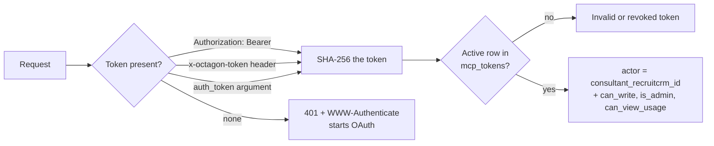
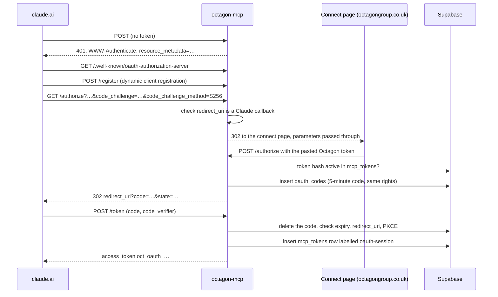
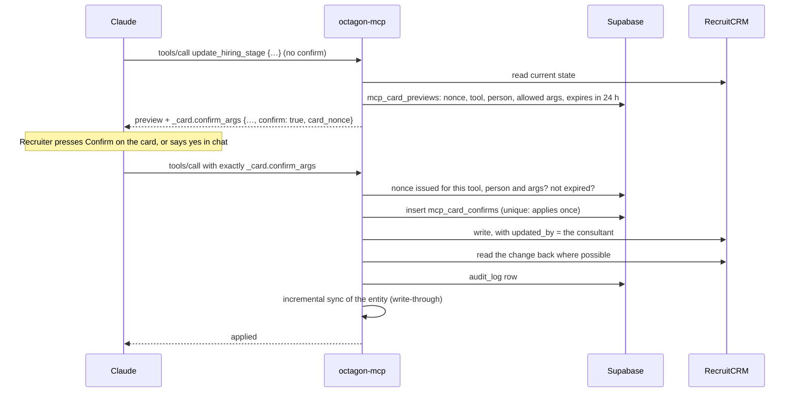

import { Aside, Steps, Tabs, TabItem, Card, CardGrid, LinkCard, Badge } from '@astrojs/starlight/components';
import platform from '../../../data/platform.json';
import prompts from '../../../data/prompts.json';

For developers changing `octagon-mcp` and admins supporting people who use it: how a request is authenticated, how a write is gated, and how the inline widgets are built and checked.

<CardGrid>
	<Card title="Version" icon="information">
		`octagon-mcp` {platform.connectorVersion}
	</Card>
	<Card title="Tools" icon="puzzle">
		{platform.toolCount} tools: {platform.readTools} read, {platform.writeTools} write. Full list in the [tools reference](/run/tools/).
	</Card>
	<Card title="Prompts" icon="document">
		{platform.promptCount} prompt templates, listed [below](#prompts).
	</Card>
	<Card title="Widgets" icon="laptop">
		5 inline MCP Apps pages: dashboard, scorecard, confirm card, report view, mixed.
	</Card>
</CardGrid>

## Shape of the server

`octagon-mcp` is a remote MCP server on a single Supabase edge function, speaking JSON-RPC over **streamable HTTP**. It lives in three source files plus one shared helper:

| File | Holds |
|---|---|
| [`index.ts`](https://github.com/ollielarkins/octagonanalytics-reverse/blob/main/supabase/functions/octagon-mcp/index.ts) | `SERVER` (name and version), `TOOLS`, `PROMPTS`, authentication, the OAuth bridge, the confirm gate, every tool's implementation |
| [`widgets.ts`](https://github.com/ollielarkins/octagonanalytics-reverse/blob/main/supabase/functions/octagon-mcp/widgets.ts) | The five widget HTML pages and their `ui://` resource URIs |
| [`ext_apps_bundle.ts`](https://github.com/ollielarkins/octagonanalytics-reverse/blob/main/supabase/functions/octagon-mcp/ext_apps_bundle.ts) | Generated: the MCP Apps SDK browser client, inlined. Do not edit by hand |
| `../_shared/graph.ts` | Microsoft Graph client for the inbox tools |

| Request | Response |
|---|---|
| `GET` (any path not below) | `{"name":"octagon-analytics","version":"…","transport":"streamable-http"}`, no token needed |
| OAuth paths | See [Authentication](#authentication) |
| `POST` JSON-RPC | `initialize`, `tools/list`, `tools/call`, `prompts/list`, `prompts/get`, `resources/list`, `resources/read`. Batches are accepted |

`initialize` advertises the `io.modelcontextprotocol/ui` extension (MIME `text/html;profile=mcp-app`) and sends the server instructions, which carry two rules: RecruitCRM is changed through Octagon tools only, never a browser; every write previews first and applies only on confirmation.

## Authentication

Every tool call must carry a valid Octagon token. The token fixes who is acting; nothing in a tool's arguments can change that.



### `mcp_tokens`

| Column | Meaning |
|---|---|
| `token_hash` | SHA-256 of the token. The plaintext is never stored |
| `consultant_recruitcrm_id` | Who is acting. `0` is the admin sentinel: no consultant record, so no personal desk |
| `can_write` | Allowed to confirm writes |
| `is_admin` | Admin tools and the firm-wide view |
| `can_view_usage` | Manager view: team usage and whole-team read-only reports alongside their own desk |
| `label` | Free text, e.g. `Name (Recruiter)`, or `oauth-session` for tokens the OAuth bridge issued |
| `active` | `false` revokes it at once |
| `last_used_at` | Updated on every call |

Admins mint tokens in the SQL editor and manage them from Claude with `/tokens`. See [Tokens](/run/runbook/#tokens-and-access).

### The OAuth bridge and the connect page

claude.ai's custom connectors need OAuth, and Supabase cannot serve rendered HTML (edge functions force `text/plain`). So the login form, [`web/octagon-connect.html`](https://github.com/ollielarkins/octagonanalytics-reverse/blob/main/web/octagon-connect.html), is hosted on the Octagon website and posts back to the function.



- **PKCE S256 is required.** Plain challenges are refused.
- **Redirects are allow-listed** (since 3.85.0, 29/10/2026): only `https://claude.ai/api/mcp/auth_callback`, `https://claude.com/api/mcp/auth_callback`, or `http://localhost` / `127.0.0.1` for local clients. Any other `redirect_uri` is refused on both the `GET` and the `POST`.
- **The session token inherits the pasted token's rights**, including `is_admin`, so re-authenticating does not silently demote an admin.
- Each code is single-use and expires after 5 minutes.

<Aside type="caution">
The token response says `expires_in` 90 days, but session tokens do not expire: they last until revoked. Revoking a person with `/tokens`, or the leaver trigger, switches off their OAuth sessions too.
</Aside>

<Aside type="caution" title="The connect page goes through WordPress">
WordPress inserts paragraph tags at blank lines, including inside `<script>` and `<style>`, which broke OAuth sign-in on 10/08/2026. Keep those blocks free of blank lines and run `node scripts/check-connect-page.js` before publishing the page.
</Aside>

## The write path

Every write tool is two-step: a call without `confirm` returns a preview, and a confirm is applied only if it answers that preview exactly.



| Refusal | Why | Nothing changed? |
|---|---|---|
| `preview_required` | Confirm with no `card_nonce` | Yes |
| `preview_mismatch` | Nonce unknown, or issued for another tool, person or argument set | Yes |
| `preview_expired` | Preview older than 24 hours | Yes |
| `already_applied` | That nonce was confirmed before (with the time) | Yes, this time |
| `card_check_failed` | The gate could not reach the database | Yes |

Implementation notes:

- **Arguments are canonicalised** (keys sorted, nulls dropped, `confirm`, `card_nonce`, `auth_token` and `confirm_name` removed) before comparison, so a faithful copy of `confirm_args` always matches.
- **A failed write releases its nonce** (3.100.1, 06/11/2026). Before that, a retry of a refused `create_job` said "already applied" and Claude told the recruiter it was done.
- **Stage moves are optimistic-concurrency checked.** `update_hiring_stage` carries `expected_status_id` from the preview and refuses if the candidate has moved since.
- **`send_email` previews offer a draft as well as a send**, each with its own allowed argument set under the same nonce.
- **Extra guards:** off-limit checked live and failing closed on every client-facing path; `delete_record` needs `confirm_name` typed back; batches stop at 25 records per confirmation; email never goes to an opted-out person.

See [Security](/run/security/#the-confirm-gate) for why each guard exists.

## Inline widgets (MCP Apps)

Tool results render as inline widgets in Claude. Each tool's `_meta.ui.resourceUri` names its widget, and the widget pages are served through `resources/read`.

| Widget | Resource | Used by |
|---|---|---|
| Dashboard | `ui://octagon/dashboard` | `get_dashboard`: a summary card with an open-full-screen view, branching on recruiter, manager or admin |
| Scorecard | `ui://octagon/scorecard` | `weekly_kpis`, `billing` |
| Confirm card | `ui://octagon/confirm` | Card tools: `update_hiring_stage`, `assign_candidate`, `add_note`, `create_job`, `update_deal`, `delete_record`, `send_email`, `draft_reply` and the other two-step writes |
| Report view | `ui://octagon/report` | Over 40 read tools: headline figures inline with a full view |
| Mixed | `ui://octagon/mixed` | Tools that read and write: `off_limit`, `hotlist`, `inbox`, `call_tagging`, `meeting_review`, `push_tell`, `eow_email`, `manage_tokens`, `webhook_subscriptions`, `client_status` |

The sets are `CARD_TOOLS`, `REPORT_TOOLS` and `MIXED_TOOLS` in `index.ts`. Take a tool out of its set to stop it rendering.

Each widget is one self-contained HTML page: the MCP Apps SDK client inlined, the Octagon theme kit and a render function. Nothing loads from outside, and the resource metadata declares an empty CSP allow-list (`connectDomains: []`, `resourceDomains: []`).

<Tabs>
<TabItem label="Rebuilding the SDK bundle">

`ext_apps_bundle.ts` is generated from `@modelcontextprotocol/ext-apps` (1.7.5 as of 09/11/2026). The script rewrites the bundle's trailing `export{…}` to `window.McpApps={…}` and escapes `</script` so it runs as a plain inline script.

```bash
npm pack @modelcontextprotocol/ext-apps@1.7.5
tar xzf modelcontextprotocol-ext-apps-1.7.5.tgz
node scripts/build-ext-apps-bundle.js package/dist/src/app-with-deps.js 1.7.5
```

</TabItem>
<TabItem label="Checking the widgets">

Run after every change to `widgets.ts`. It imports the module as the server does (Node 22.18 or newer) and parses every `<script>` in each emitted page, because an escape lost in a template literal only shows in the output. That bug left the dashboard widget broken for hours on 10/08/2026.

```bash
node scripts/check-widgets.js
# OK   DASHBOARD_WIDGET_HTML — 3 scripts parse, … KB
# OK   SCORECARD_WIDGET_HTML — 3 scripts parse, … KB
# ...
```

</TabItem>
</Tabs>

Scoped dashboards (`dashboard "clients"` and the like) are not connector widgets: the `octagon-dashboard` plugin draws them from the tool's data. See [Plugins](/run/plugins/).

## Prompts

Prompt templates are content work that calls no tool on its own; each is logged as `prompt:<name>` so usage reports can see it.

<table>
	<thead>
		<tr><th>Prompt</th><th>What it does</th></tr>
	</thead>
	<tbody>
		{prompts.map((p) => (
			<tr><td><code>{p.name}</code></td><td>{p.description}</td></tr>
		))}
	</tbody>
</table>

## Usage logging

Every tool call writes a row to `mcp_call_log` with the actor, the tool, whether it succeeded and any error code. Opening the connector logs `_session`, so `usage_report` can tell "connected, never used a tool" from "never connected". Admins see this through `/usage`, `/adoption` and `/map`.

## Versioning

- **Bump `SERVER.version`** in `index.ts` on every change to a tool or its behaviour. It is the only way to tell from outside which build is live.
- Confirm the live build after deploying: a plain `GET` returns the version. A `502` straight after a deploy is a cold boot; retry before assuming failure.
- **Plugins depend on connector versions.** A command that needs a new tool ships after the connector release that adds it. After a release adds tools, people may need to reconnect or start a new chat before they appear, because clients cache tool lists.
- The [tools reference](/run/tools/) is generated from the `TOOLS` and `PROMPTS` arrays in `index.ts` by `site/scripts/generate.mjs`, so it describes the source in `main`, not necessarily the deployed build.

<CardGrid>
	<LinkCard title="Tools reference" href="/run/tools/" description="Every tool, generated from the connector source." />
	<LinkCard title="Making changes safely" href="/use/making-changes/" description="The write path as recruiters see it." />
</CardGrid>
