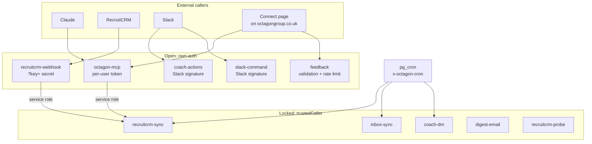

import { Aside, Badge, Tabs, TabItem, LinkCard, CardGrid } from '@astrojs/starlight/components';

For developers deploying or changing a function and admins checking who can reach what. Secrets are listed by name only; values live in Supabase function secrets and Vault, never in the repo.

## Who calls what



## Two kinds of protection

`verify_jwt` for every function is declared in [`supabase/config.toml`](https://github.com/ollielarkins/octagonanalytics-reverse/blob/main/supabase/config.toml), with a comment giving the reason, so it travels with the repo and a stray CLI flag cannot flip it.

- **Open** (`verify_jwt = false`) only where an external caller cannot present a Supabase JWT. Each one authenticates its own callers before doing anything.
- **Locked** (`verify_jwt = true`) **plus** `trustedCaller()`. `verify_jwt` alone only proves the caller holds some project JWT, and the anon key is public. So every locked function also checks [`_shared/caller.ts`](https://github.com/ollielarkins/octagonanalytics-reverse/blob/main/supabase/functions/_shared/caller.ts):

```ts
import { forbidden, trustedCaller } from "../_shared/caller.ts";

Deno.serve(async (req) => {
  if (!trustedCaller(req)) return forbidden();   // 403 {"error":"forbidden"}
  // ...
});
```

`trustedCaller()` accepts exactly two callers, compared in constant time:

| Caller | Presents | Used by |
|---|---|---|
| Another function | The service-role key as its bearer | `octagon-mcp` write-through, `recruitcrm-webhook` |
| `pg_cron` | `x-octagon-cron` equal to `CRON_SECRET` (at least 32 characters) | Scheduled jobs, through `public.cron_headers()` (0132), which reads the secret from Vault |

It fails closed: with `CRON_SECRET` unset, only the service-role key gets in.

## Live functions

| Function | What it does | Protection | Secrets |
|---|---|---|---|
| `octagon-mcp` | The [connector](/run/connector/): remote MCP server over streamable HTTP, OAuth bridge, inline widgets, audited writes to RecruitCRM | <Badge text="Open" variant="caution" /> Per-user token checked against `mcp_tokens` on every call | `RECRUIT_CRM_API_TOKEN`, `WEBHOOK_SECRET`, `MS_TENANT_ID`, `MS_CLIENT_ID`, `MS_CLIENT_SECRET` |
| `recruitcrm-sync` | The mirror. See [Sync](/run/sync/#sync-modes) | <Badge text="Locked" variant="success" /> JWT + `trustedCaller()` | `RECRUIT_CRM_API_TOKEN`, `CRON_SECRET` |
| `recruitcrm-webhook` | Logs RecruitCRM change events, tombstones deletions, fires an incremental sync | <Badge text="Open" variant="caution" /> Shared `?key=` secret (or `x-webhook-key` header) | `WEBHOOK_SECRET` |
| `inbox-sync` | Polls connected Outlook inboxes via Microsoft Graph every 5 minutes; stores envelopes only | <Badge text="Locked" variant="success" /> JWT + `trustedCaller()` | `MS_TENANT_ID`, `MS_CLIENT_ID`, `MS_CLIENT_SECRET`, `CRON_SECRET` |
| `coach-dm` | Sends the Octagon Coach DMs. See [Slack](/run/slack/) | <Badge text="Locked" variant="success" /> JWT + `trustedCaller()` | `COACH_BOT_TOKEN`, `CRON_SECRET` |
| `coach-actions` | The Coach's buttons; one-press call tagging is its only RecruitCRM write | <Badge text="Open" variant="caution" /> Slack request signature | `COACH_SIGNING_SECRET`, `COACH_BOT_TOKEN`, `RECRUIT_CRM_API_TOKEN` |
| `slack-command` | Slack `/dashboard` and `/kpis` | <Badge text="Open" variant="caution" /> Slack request signature | `SLACK_SIGNING_SECRET` |
| `feedback` | Issue, feedback and feature box on the connect page. Stores submissions, serves no data | <Badge text="Open" variant="caution" /> Validation, honeypot, length cap, rate limit | `RESEND_API_KEY`, `FEEDBACK_FROM`, `FEEDBACK_TO` |
| `digest-email` | Renders the morning, evening and weekly digests as email. Deployed, not scheduled by any cron job | <Badge text="Locked" variant="success" /> JWT + `trustedCaller()` | `RESEND_API_KEY`, `DIGEST_FROM`, `CRON_SECRET` |
| `recruitcrm-probe` | Read-only API shape probe: returns field names and value types, never values. Temporary | <Badge text="Locked" variant="success" /> JWT + `trustedCaller()` | `RECRUIT_CRM_API_TOKEN`, `CRON_SECRET` |

Every function that touches the database also receives `SUPABASE_URL` and `SUPABASE_SERVICE_ROLE_KEY`, which Supabase injects automatically.

<Aside type="note" title="Secret name fallback">
The RecruitCRM token is read as `RECRUIT_CRM_API_TOKEN`, falling back to `RECRUITCRM_API_TOKEN`. Set the first.
</Aside>

### Open-function details

<Tabs>
<TabItem label="octagon-mcp">

- `GET /` returns the build: `{"name":"octagon-analytics","version":"3.x.y","transport":"streamable-http"}`. No token needed; this is how a deploy is checked.
- OAuth endpoints (`/.well-known/...`, `/register`, `/authorize`, `/token`) are public by design and described in [The connector](/run/connector/#authentication).
- Any `POST` JSON-RPC call without a valid token gets `401` with a `WWW-Authenticate` header pointing at the protected-resource metadata, which starts claude.ai's OAuth flow.

</TabItem>
<TabItem label="recruitcrm-webhook">

- Rejects with `401 unauthorized` unless the `key` query parameter (or `x-webhook-key` header) equals `WEBHOOK_SECRET`. Unset secret means every request is refused.
- Uses the service-role key only to call `recruitcrm-sync` and write `webhook_events`.

</TabItem>
<TabItem label="coach-actions, slack-command">

- Both verify Slack's HMAC-SHA256 request signature with their own app's signing secret, compare in constant time, and refuse timestamps older than 5 minutes, before reading anything else in the request.
- `slack-command` acknowledges within Slack's 3-second budget and posts the result to `response_url` afterwards.

</TabItem>
<TabItem label="feedback">

- `POST` only, JSON body with `kind` of `issue`, `feedback` or `feature` and a `message` of at least 5 characters, capped at 4,000.
- A filled hidden `website` field (the honeypot) gets a silent `200`.
- At most 5 submissions per IP in 10 minutes, else `429`.
- Stores the row first, then notifies best-effort by Slack (`admin_webhook_url` in `app_settings`) and email, so a delivery failure never loses a submission.

</TabItem>
</Tabs>

## Retired functions

| Function | State |
|---|---|
| `dashboard` | 410 Gone, no data, since 03/11/2026. It rendered firm figures and every consultant by name to anyone with the URL. Left open so old links get a clear 410 |
| `dashboard-data` | 410 Gone, no data, since 03/11/2026. Its JSON twin, which returned firm revenue and per-consultant figures |
| `recruitcrm-discover` | 410 stub, locked by `verify_jwt`. Its endpoint findings are recorded in the migrations |
| `storage-upload` | Retired. No source in the repo; `verify_jwt = true` stays in `config.toml` |
| `daily-queue`, `slack-actions` | Removed 09/11/2026 with the "(Claude) - Team Briefs" Slack app (0158). Their secrets `SLACK_BOT_TOKEN` and `SLACK_BRIEFS_SIGNING_SECRET` are no longer used |

The live dashboard is now the connector's `get_dashboard` widget, behind each person's token.

## Adding a function

- A new locked function imports `trustedCaller` and returns `forbidden()` otherwise. `verify_jwt = true` alone is not protection.
- Add a `[functions.<name>]` block to `config.toml` with a comment explaining the choice.
- Scheduled calls use `public.cron_headers()`, never the anon key.
- Deploy one function per command and never pass `--no-verify-jwt`. See the [runbook](/run/runbook/#deploying).

<CardGrid>
	<LinkCard title="Security model" href="/run/security/" description="How the function protections fit the wider model." />
	<LinkCard title="Runbook: deploying" href="/run/runbook/#deploying" description="The deploy commands and the checks afterwards." />
</CardGrid>
