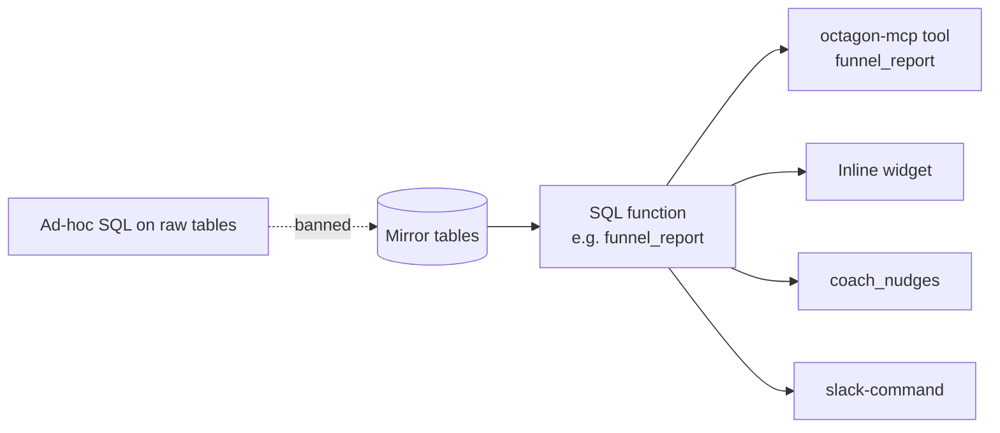

import { Aside, Steps, LinkCard, CardGrid, Tabs, TabItem } from '@astrojs/starlight/components';

For developers changing a report and admins debugging one: where each number is defined, who it credits, and why nothing is allowed to compute a figure anywhere else. The recruiter-facing definitions are in [Metrics and definitions](/use/metrics/); this page is the layer underneath.

## One definition per metric

Every figure the platform shows comes from one SQL function or view in `supabase/migrations/`. The connector, its widgets, the Coach and `slack-command` all call the same function, so their numbers cannot disagree.



<Aside type="danger" title="No ad-hoc SQL against raw tables">
Never compute a reported figure by querying `candidate_stage_events`, `deals` or `call_activity` directly, in a tool, a Slack job or an answer. The platform's own audit found the same metric computed from three different tables, which cannot agree (decision D1). Raw queries also skip the rules the functions apply: deleted rows, distinct candidate-job pairs, actor attribution, UK-time windows with exclusive ends. If a figure has no function, write one in a migration.
</Aside>

## How the functions are built

| Rule | Detail |
|---|---|
| `security definer`, revoked by default | Report functions are revoked from `public`, `anon` and `authenticated` and called with the service role (0107). Grant back only what a caller needs, with a comment saying why |
| `search_path` pinned | `set search_path = public, pg_temp` on every `security definer` function |
| Views are `security_invoker` | Repeat `WITH (security_invoker = on)` on every `CREATE OR REPLACE VIEW`: re-creating a view resets it. 0075 dropped it and made a view readable with the anon key until 0084 |
| Return shape | Most report functions return one `jsonb` document that the tool passes through with light shaping |
| Windows | UK time, start inclusive, end exclusive. Default 2026 year to date, because hiring-stage logging before 2026 is sparse (D8) |
| Deleted rows | Hidden from operational views (who to call, what is stalled) and kept in historical counts (0075) |

## Attribution

| Metric family | Credited to | Since |
|---|---|---|
| Funnel activity, CV Sent to Placed (`funnel_report`, `kpis_report`, `consultant_leaderboard`) | **The actor** who made the stage move, falling back to the job owner | 0066, 02/09/2026 |
| Desk views (`cold_jobs`, `stalled_report`, `time_to_fill`, `placements_report`, `rejection_report`, `silver_medallists`) | **The job owner**: whose desk it is now | D9 |
| Calls | **The caller** (`created_by` on the call log) | 0027 |
| Billing, fees, aftercare | **The deal owner** (`deals.owner_recruitcrm_id`) | D5 |
| Leads, internal interviews, job order forms | **The note author** | `notes_kpi_report` |

Identity is always `consultants.recruitcrm_id`, never a name (D7). Leavers keep their history and stay in totals, tagged "left"; nothing is reattributed.

<Aside type="note" title="Why actor, not owner, for the funnel">
Decision D9 first credited the job owner, because RecruitCRM's `updated_by` includes admins moving stages on colleagues' candidates. Checked against RecruitCRM's January report, actor attribution matched 20 of 27 per-consultant figures where owner attribution scattered. The `updated_by` double-counting was handled instead by counting **distinct candidate-job pairs** (0065), each at the last time it entered a stage.
</Aside>

## Metric to function

The tool column links to the generated [tools reference](/run/tools/).

<Tabs>
<TabItem label="Funnel and KPIs">

| Metric | Function | Tool |
|---|---|---|
| Funnel stages and conversion ratios | `funnel_report()` | [`funnel_report`](/run/tools/#funnel_report) |
| Weekly KPIs against targets | `kpis_report()`, `weekly_plan()` | [`weekly_kpis`](/run/tools/#weekly_kpis) |
| The dashboard | `dashboard_json()` | [`get_dashboard`](/run/tools/#get_dashboard) |
| Leaderboard | `consultant_leaderboard()` | [`consultant_leaderboard`](/run/tools/#consultant_leaderboard) |
| Yesterday's CVs and interview requests by name | `daily_activity()` | [`daily_activity`](/run/tools/#daily_activity) |
| Rejections | `rejection_report()` | [`rejection_report`](/run/tools/#rejection_report) |
| Time to fill | `time_to_fill()` | [`time_to_fill`](/run/tools/#time_to_fill) |
| Per-client activity | `client_report()` | [`client_report`](/run/tools/#client_report) |

</TabItem>
<TabItem label="Money">

| Metric | Function | Tool |
|---|---|---|
| Quarter billing and pipeline | `billing_report()` | [`billing`](/run/tools/#billing) |
| Fee percentage, salary bands, forecast | `fee_analysis()` | [`fee_analysis`](/run/tools/#fee_analysis) |
| Deals by consultant | `deals_by_consultant()` | [`deals_by_consultant`](/run/tools/#deals_by_consultant) |
| Placements and their fees | `placements_report()`, `placements_with_fees()`, `placement_deal_match()` | [`placements_with_fees`](/run/tools/#placements_with_fees) |
| Claude's part in deals | `claude_deals()` | [`claude_deals`](/run/tools/#claude_deals) |

</TabItem>
<TabItem label="Desk and chasing">

| Metric | Function | Tool |
|---|---|---|
| Attention list | `my_day()` | [`my_day`](/run/tools/#my_day) |
| Ranked calls | `action_queue()` | [`action_queue`](/run/tools/#action_queue) |
| Stalled and aging offers | `stalled_report()` | [`stalled_report`](/run/tools/#stalled_report) |
| Cold jobs | `cold_jobs()` | [`cold_jobs`](/run/tools/#cold_jobs) |
| Unbooked interview requests | `interview_requests_unbooked()` | [`interview_requests_unbooked`](/run/tools/#interview_requests_unbooked) |
| Awaiting feedback | `awaiting_feedback_report()` | [`awaiting_feedback_report`](/run/tools/#awaiting_feedback_report) |
| Silver medallists | `silver_medallists()` | [`silver_medallists`](/run/tools/#silver_medallists) |
| Aftercare | `aftercare()` | [`aftercare`](/run/tools/#aftercare) |
| Lapsed clients | `lapsed_clients()` | [`lapsed_clients`](/run/tools/#lapsed_clients) |
| Client visits | `client_visits()` | [`client_visits`](/run/tools/#client_visits) |
| Data hygiene | `data_hygiene()` | [`data_hygiene`](/run/tools/#data_hygiene) |

</TabItem>
<TabItem label="Calls, notes, BD">

| Metric | Function | Tool |
|---|---|---|
| Calls, connect rate, talk time | `call_activity_report()` | [`call_activity`](/run/tools/#call_activity) |
| Calls by hour, evening calls | `call_hours_report()` | [`call_hours_report`](/run/tools/#call_hours_report) |
| Tagging rate | `call_tagging_rates()` | Coach and digests |
| Probable type of an untagged call | `likely_call_type()` | [`call_tagging`](/run/tools/#call_tagging) |
| Leads, internal interviews, JOFs | `notes_kpi_report()` | [`notes_kpi`](/run/tools/#notes_kpi) |
| BD pipeline | `bd_report()` | [`bd_report`](/run/tools/#bd_report) |
| New jobs and missing JOFs | `new_jobs_report()` | [`new_jobs_report`](/run/tools/#new_jobs_report) |

</TabItem>
<TabItem label="Admin">

| Metric | Function | Tool |
|---|---|---|
| Sync health | `sync_health()` | [`platform_health`](/run/tools/#platform_health) |
| Cron drift | `check_cron_manifest()` | [`platform_health`](/run/tools/#platform_health) |
| Usage | `usage_report()` | [`usage_report`](/run/tools/#usage_report) |
| Team usage (not performance) | `team_insights()` | [`team_insights`](/run/tools/#team_insights) |
| Manager exceptions | `team_exceptions()` | [`team_exceptions`](/run/tools/#team_exceptions) |
| End-of-week email data | `eow_report()` | [`eow_email`](/run/tools/#eow_email) |
| Coach nudges and their effect | `coach_nudges()`, `coach_effect()` | Coach only |

</TabItem>
</Tabs>

A few tools read RecruitCRM live rather than the mirror, because the data is deliberately not stored or must be current: `call_notes`, `pitch_history`, `files_list`, `job_spec`, and the off-limit check on every client-facing write.

## Example: calling a report function

From the SQL editor (service role), with the same arguments the tool passes:

```sql
-- the 2026 funnel for one consultant, end exclusive
select public.funnel_report(p_from => '2026-01-01', p_to => '2026-11-09',
                            p_consultant => '<consultant name>', p_team => null);

-- this week's KPIs, every recruiter
select public.kpis_report();

-- quarter billing and pipeline
select public.billing_report();
```

<Aside type="note">
Argument lists differ between functions and have changed across migrations. Check the current signature with `\df public.funnel_report` or `pg_get_function_arguments()` before calling one by hand.
</Aside>

## Changing a metric

<Steps>

1. **Write the new version as a temporary function** and compare it with the live one in a single `execute_sql` call, so nothing permanent changes:

   ```sql
   create function pg_temp.billing_report_v2() returns jsonb
   language sql as $$ /* new body */ $$;

   select public.billing_report() as live,
          pg_temp.billing_report_v2() as candidate;
   ```

2. **Spot-check against RecruitCRM.** Numbers must match it, not a spreadsheet (D8).

3. **Apply the real migration** with the next number, `create or replace`, the revoke and `search_path` lines, and a header comment saying why, with the evidence.

4. **Record the change of meaning** as a new entry in [`docs/DECISIONS.md`](https://github.com/ollielarkins/octagonanalytics-reverse/blob/main/docs/DECISIONS.md). Never edit an old entry.

5. **Update the recruiter docs** in [Metrics and definitions](/use/metrics/) if the definition changed.

</Steps>

See [Contributing](/run/contributing/#migrations) for the full migration rules.

<CardGrid>
	<LinkCard title="Metrics and definitions" href="/use/metrics/" description="The recruiter-facing definition of every number." />
	<LinkCard title="Data caveats" href="/use/data-caveats/" description="Where the numbers are soft, and why." />
</CardGrid>
