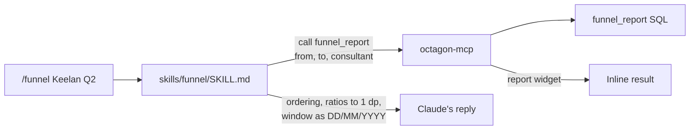

import { Aside, Steps, FileTree, LinkCard, CardGrid, Badge } from '@astrojs/starlight/components';
import platform from '../../../data/platform.json';

For whoever writes or ships a slash command. Recruiters' view of the same commands is in [Commands](/use/commands/).

## Where the commands live

The {platform.commandCount} slash commands are **not in this repo**. They are skills in four Claude plugins in the separate [octagon-plugins](https://github.com/ollielarkins/octagon-plugins) repository, a private Claude plugin marketplace registered org-wide in claude.ai's admin settings. Every member gets the plugins they are enabled for, with no per-user install.

<FileTree>
- octagon-plugins/
  - .claude-plugin/
    - marketplace.json the catalogue, with each plugin's version
  - ADMIN-SETUP.md publish and update instructions
  - plugins/
    - octagon-dashboard/
      - .claude-plugin/
        - plugin.json name, version, description
      - skills/
        - dashboard/
          - SKILL.md one skill per slash command
        - kpi/
    - octagon-reporting/
    - octagon-actions/
    - octagon-admin/
</FileTree>

`plugins/octagon-analytics/` in this repo is a pointer only (see [`COMMANDS-MOVED.md`](https://github.com/ollielarkins/octagonanalytics-reverse/blob/main/plugins/octagon-analytics/COMMANDS-MOVED.md)). It keeps `.mcp.json` and `hooks/` as a record of how the connector and the session-start hook were configured.

### Why they moved

- **The old plugin was never installed.** `octagon-analytics` was not registered in any `known_marketplaces.json`, so every command written in it was unreachable. `octagon-dashboard` was the plugin the team actually had, and it keeps its name so existing installs update rather than break.
- **Access.** Installing a plugin from this repo would point every recruiter's Claude at the engineering repo: migrations, function source, RecruitCRM integration detail. The plugins repo bundles no credentials and no platform code.
- **One copy.** Two copies of a command drift, and the one that gets edited is never the one that ships. Edit commands only in octagon-plugins.

## The four plugins

They are split by **blast radius**, not by theme. Everything that changes RecruitCRM is in `octagon-actions`, so write access is controlled by who receives that plugin as well as by `can_write` on each connector token.

<table>
	<thead>
		<tr><th>Plugin</th><th>Version</th><th>Commands</th><th>What it is for</th></tr>
	</thead>
	<tbody>
		{platform.plugins.map((p) => (
			<tr><td><code>{p.id}</code></td><td>{p.version}</td><td>{p.commands}</td><td>{p.blurb}</td></tr>
		))}
	</tbody>
</table>

| Plugin | Give it to |
|---|---|
| `octagon-dashboard`, `octagon-reporting` | Everyone |
| `octagon-actions` | Only people who should write to RecruitCRM |
| `octagon-admin` | Managers and admins. The connector refuses admin tools to anyone else either way |

<Aside type="note">
`octagon-reporting` is mostly read-only. A few skills (`/intake`, `/myday`, `/queue`, `/visitplan`) offer a change at the end, which still goes through the connector's preview and confirm.
</Aside>

## How a skill maps to tools

A skill is instructions, not code. It tells Claude which connector tools to call, with which arguments, and how to present the result. The connector does the work and enforces the rules; the skill shapes the answer.



An abridged real skill, `octagon-reporting/skills/funnel/SKILL.md`:

```md
---
name: funnel
description: The recruitment funnel and conversion ratios for any window, firm or
  per consultant. Use when the recruiter types /funnel or asks for this directly.
---

Usage: `/funnel` — `/funnel Keelan Riley Q2` — `/funnel the tech team last month`

Call `funnel_report`. Defaults to 2026 YTD; pass `from`, `to`, `consultant` (partial name) or
`team`. `to` is exclusive. State the window as DD/MM/YYYY.

Present stages in order — CV Sent → Interview Request → 1st → 2nd → 3rd → Offered → Placed —
then the ratios, each named ...
```

The `description` decides when Claude picks the skill, so it names the slash command and the plain-English requests that should trigger it. `site/scripts/generate.mjs` records, for every command, the tools its skill calls (in `src/data/commands.json`), so each command can be traced to its entries in the [tools reference](/run/tools/).

## Adding or changing a command

<Steps>

1. **Check the tool exists.** If the command needs a new tool or argument, ship the connector release first and confirm the live version. See [The connector](/run/connector/#versioning).

2. **Write the skill** in `octagon-plugins/plugins/<plugin>/skills/<command>/SKILL.md`, in the plugin that matches its blast radius. A command that writes goes in `octagon-actions`, whatever its theme.

3. **Bump the version in both places**: `plugins/<plugin>/.claude-plugin/plugin.json` and that plugin's entry in `.claude-plugin/marketplace.json`. The version bump is what makes members pull the new copy.

4. **Commit and push** to the octagon-plugins repo. Org sync picks it up through the Claude GitHub App.

5. **Regenerate this site's data.** `site/scripts/generate.mjs` reads the skills, so the [Commands](/use/commands/) page and the counts here update on the next site build.

</Steps>

<Aside type="caution">
After a connector release adds tools, people may need to reconnect the connector or start a new chat before the new tools appear, because clients cache tool lists. A command shipped before its tool is live fails for everyone.
</Aside>

### Requirements the plugins assume

| Requirement | Why |
|---|---|
| The Octagon connector connected org-wide | All four plugins rely on it and bundle no `.mcp.json`; adding one would define a duplicate connector |
| `octagon-mcp` 3.64.0 or later | The bare `dashboard` is the connector's own inline widget |
| `octagon-mcp` 3.81.0 or later | `/queue`, `/visitplan`, `/tagcalls`, `/exceptions` |
| The `visualize` render tool | Scoped dashboards (`dashboard "clients"`) are drawn with it from fresh connector data |

## The session-start dashboard

Each chat is meant to open with the dashboard, then a short "your day".

- The connector's `get_dashboard` description tells Claude to call it at the start of a conversation, and the organisation's instructions in claude.ai say the same (source in [`rollout/`](https://github.com/ollielarkins/octagonanalytics-reverse/blob/main/rollout/org-instructions.md)).
- The `dashboard` skill handles the reply: call `get_dashboard` and stop, do not restate the widget, and add one line only if `health.overall` is not `ok`.
- `plugins/octagon-analytics/hooks/hooks.json` holds a `SessionStart` hook that ran `scripts/session-start-dashboard.sh` to inject the same instruction as `additionalContext`. It is kept as a record and is **not** part of any shipped plugin.

<Aside type="note">
The archived hook script's text predates two changes: it names the old `octagon-analytics` connector and describes per-consultant figures as attributed by job owner. Funnel activity has been credited to the actor since 0066. Do not revive the script without updating it.
</Aside>

<CardGrid>
	<LinkCard title="Commands" href="/use/commands/" description="Every command, generated from the skills." />
	<LinkCard title="Tools reference" href="/run/tools/" description="The tools the skills call." />
</CardGrid>
