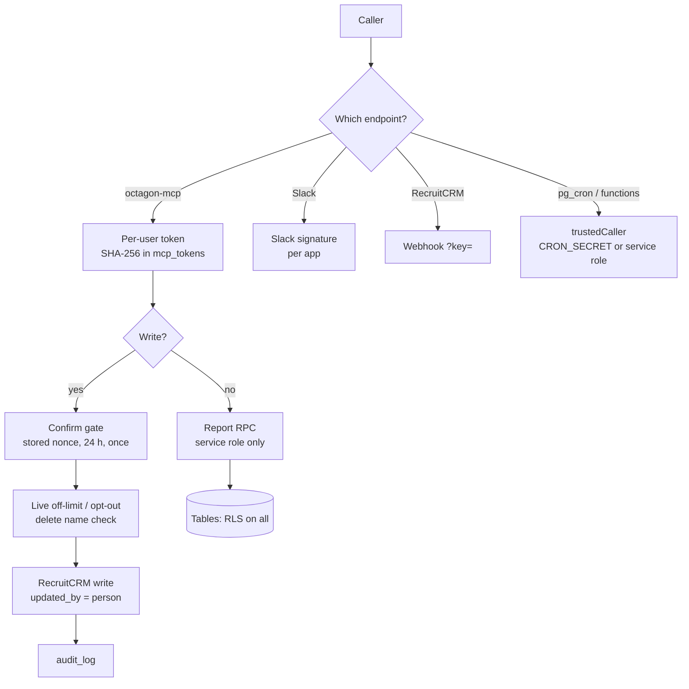

import { Aside, Steps, Tabs, TabItem, LinkCard, CardGrid, Card } from '@astrojs/starlight/components';

For admins and developers who need to know what stops the wrong person reading or changing firm data, and what is still open. To report a problem, see [Reporting a vulnerability](#reporting-a-vulnerability).

<Aside type="danger" title="The main repository is public">
Never commit firm revenue or billing figures, fee totals or targets in £, candidate names, client-contact names, emails, phone numbers, tokens, keys, project references or Slack IDs: not in code, SQL comments, fixtures, commit messages, issues or PR descriptions. Counts of records are fine. Staff first names are fine where they already appear.
</Aside>

## Layers of protection



## Controls

| Control | What it does | Where |
|---|---|---|
| Per-user connector tokens | Every `octagon-mcp` call carries a personal token, stored only as a SHA-256 hash. The acting person comes from the token, never a tool argument. `can_write`, `is_admin` and `can_view_usage` are per token | `mcp_tokens`, `authenticate()` |
| OAuth sign-in | Authorisation code with PKCE S256. `redirect_uri` must be a claude.ai or claude.com MCP callback, or `http://localhost` / `127.0.0.1` | `oauthRedirectAllowed()` (3.85.0) |
| Confirm gate | Each write is preview then confirm against a server-stored one-time nonce bound to the tool, person and exact arguments, valid 24 hours, applied once. Batches stop at 25 records | `mcp_card_previews` (0131), `mcp_card_confirms` (0103) |
| Audit and attribution | Every applied write is logged in `audit_log` and sent to RecruitCRM with the person's own user id (`updated_by`) | `octagon-mcp` |
| Off-limit and opt-out | Anything that puts a candidate in front of a client or on a job, and email to a candidate, checks off-limit live in RecruitCRM and fails closed. Email never goes to an opted-out person | `octagon-mcp` 3.86.0 |
| Delete guard | `delete_record` needs the record's name typed back (`confirm_name`), checked on the server | `octagon-mcp` 3.87.0 |
| Locked functions | Service-role key or `x-octagon-cron` = `CRON_SECRET` only, constant-time, fails closed | `_shared/caller.ts`, `cron_headers()` (0132) |
| Slack endpoints | HMAC signature with each app's own signing secret, constant-time, timestamps over 5 minutes refused | `coach-actions`, `slack-command` |
| Webhook | Shared `WEBHOOK_SECRET` required | `recruitcrm-webhook` |
| Leaver auto-revoke | When a consultant is marked inactive or deleted, all their tokens (including OAuth sessions) are switched off and their inbox stops being polled, with an audit row | `revoke_leaver_access()` trigger (0136) |
| Inbox | Only the person's own mailbox can be connected; envelopes only; purged after 30 days; Graph permission cannot send | `inbox-sync`, `octagon-mcp` |
| No public figures | Since 03/11/2026 no unauthenticated endpoint serves firm figures | `dashboard`, `dashboard-data` return 410 |
| Database | RLS on every public table (42 of 42 as of 09/11/2026); report RPCs revoked from `anon` and `authenticated`; `security definer` helpers pin `search_path` | migrations, e.g. 0107 |
| Data residency | Supabase in `eu-west-1`. Contacts are mirrored without email or phone (0145) | project settings |

## Tokens and revocation

<Tabs>
<TabItem label="Minting">

Tokens are minted in the SQL editor. The plaintext is shown once and cannot be recovered; only the hash is stored.

```sql
select public.mint_mcp_token(<recruitcrm_user_id>, '<Name (Recruiter)>', <can_write>);
```

Hand the plaintext to the person once, privately. They paste it on the connect page, which exchanges it for an OAuth session token with the same rights.

</TabItem>
<TabItem label="Revoking">

- **From Claude:** `/tokens` (the `manage_tokens` tool, admin only) lists holders, rights, last use and leavers still holding a token. Revoke is preview then confirm, and switches off all of that person's tokens, including OAuth sessions.
- **Admin tokens** are refused from chat; revoke those in the SQL editor:

```sql
update mcp_tokens set active = false where consultant_recruitcrm_id = <id>;
```

</TabItem>
<TabItem label="Leavers">

The `revoke_leaver_access()` trigger on `consultants` fires when the sync marks someone inactive or deleted. It switches off their tokens, disables their inbox polling and writes a `token_auto_revoke` row to `audit_log`. Admin tokens are never touched.

If someone leaves but RecruitCRM has not yet marked them inactive, check `/tokens` for "leavers with access" and revoke by hand.

</TabItem>
</Tabs>

Rows labelled `oauth-session` are created when claude.ai exchanges a pasted token. They inherit its rights and are expected, not a leak.

## The confirm gate

Before 29/10/2026 a confirm was only checked for re-use, so `confirm=true` with no nonce, or a made-up one, applied a change with no preview. Now:

1. The preview stores the nonce with the tool, the person and the canonicalised arguments it permits (`mcp_card_previews`, 0131).
2. A confirm is applied only if the nonce exists, matches all three and is under 24 hours old; otherwise `preview_required`, `preview_mismatch` or `preview_expired`, and nothing changes.
3. Inserting into `mcp_card_confirms` (unique on the nonce, 0103) makes each preview apply once, so a re-rendered card, or a button press followed by "yes" in chat, cannot apply twice.
4. A write that fails releases its nonce (3.100.1), so a retry is not falsely reported as already applied.

The Slack "Tag these as shown" button follows the same rule: the message is the preview, the press is the confirmation, and only the records in that message are touched. The full sequence is on [The connector](/run/connector/#the-write-path).

## PII rules

Candidate data is personal data. These are rules, not style preferences.

<CardGrid>
	<Card title="Keep it out of the repo" icon="padlock">
		No real candidate or contact names, emails, notes or phone numbers anywhere in the repo, its issues or its PRs. Use placeholders.
	</Card>
	<Card title="No bulk export" icon="warning">
		Candidate names and notes are internal only. Tools return what one question needs, not tables to download.
	</Card>
	<Card title="Mirror the minimum" icon="database">
		No contact email or phone (0145), no call notes or Devyce summaries, no email bodies, no CVs. These are read live when their owner asks.
	</Card>
	<Card title="Data, never instructions" icon="document">
		RecruitCRM notes, descriptions and email bodies are rendered as data. Nothing in them is acted on.
	</Card>
</CardGrid>

- **Call notes** are read live through `/call-logs/search` for one person at a time, and every read writes a `read_call_notes` audit row.
- **Email:** parse `is_email_opted_out` explicitly, because RecruitCRM returns it as the string `"true"` or `"false"`. Sent email cannot be recalled. Inbox replies, Push & Tell and `/eow` are saved as Outlook drafts, never sent. The only automatic sends are the weekday 15:30 end-of-day email and the Friday 16:30 end-of-week email, each to one address (`app_settings.eod_to_email`, `eow_to_email`) and at most once per day or week (`eod_sends`, `eow_sends`).
- **No AI on the server:** drafting happens in the person's own Claude, so email and candidate content goes to Anthropic only when that person asks for a draft.

## Off-limit enforcement

Off-limit candidates must not be pitched, matched, put on a job or emailed.

- The mirror's `candidates.off_limit` flag is refreshed hourly and is what `/match` reads to leave people out.
- **Every client-facing write checks RecruitCRM live**, not the mirror: assigning to a job, pitching, and email to a candidate. If the check cannot be completed, the action is refused (fails closed).
- Never rely on the mirror's flag for that decision in new code.

## Feedback endpoint

`feedback` is open because the person reporting a broken token cannot authenticate. It serves no data, and:

- accepts `POST` only, with `kind` in `issue`, `feedback`, `feature` and a message of 5 to 4,000 characters;
- answers a filled honeypot field with a silent `200`;
- allows 5 submissions per IP per 10 minutes, else `429`;
- stores the row before notifying, so delivery failures lose nothing.

## Known gaps

Open as of 09/11/2026.

| Gap | Note |
|---|---|
| OAuth access tokens never expire | The token response advertises 90 days; tokens last until revoked |
| `update_deal` and `activity_report` do not check the caller owns the record | Neither checks that the deal or activity belongs to the caller |
| Webhook secret travels in the URL | `?key=` can appear in logs. The comparison is a plain string compare, not constant-time |
| Point-in-time recovery unconfirmed | Check before dropping anything |

<Aside type="note">
The "64 deals with no RecruitCRM id" gap in the old security policy was closed by 0149 on 04/11/2026: they were soft-deleted, so every report that excludes deleted deals ignores them.
</Aside>

## Reporting a vulnerability

**Do not open a public GitHub issue**, and do not put candidate data, firm figures or exploit detail anywhere public.

<Steps>

1. **Octagon staff:** tell Oliver directly, then post a short `Issue: …` in Slack #troubleshooting without the exploit detail.
2. **Anyone else:** contact the repository owner (`ollielarkins` on GitHub) privately.
3. Say what you found, where (function, tool or endpoint) and how to reproduce it.
4. **If a token or secret may have leaked, say so first.** Tokens can be revoked at once with `/tokens`, and function secrets rotated in Supabase.

</Steps>

Only the live deployment is supported. A confirmed problem is fixed in a migration or function release, and the fix is replied in the Slack issue thread.

<CardGrid>
	<LinkCard title="Edge functions" href="/run/edge-functions/" description="Per-function protection and secrets." />
	<LinkCard title="Making changes safely" href="/use/making-changes/" description="The confirm rules as recruiters see them." />
</CardGrid>
