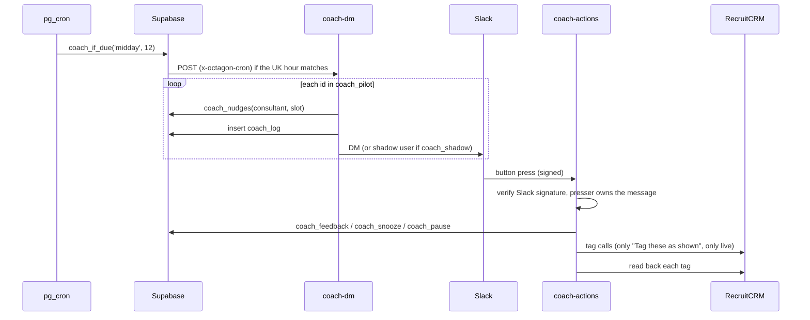

import { Aside, Steps, Tabs, TabItem, Badge, LinkCard, CardGrid } from '@astrojs/starlight/components';

For admins running the Slack side of the platform: what posts where, how the Coach decides what to say, and how to pause, measure or switch it off.

## What is in Slack

| App | Posts | Driven by | Settings and secrets |
|---|---|---|---|
| **Octagon Coach** | DMs to pilot consultants only, never channels | `coach-dm` (sends), `coach-actions` (buttons) | `COACH_BOT_TOKEN`, `COACH_SIGNING_SECRET`; `coach_pilot`, `coach_shadow`, `coach_shadow_email` |
| **analytics-admin bot** | Sync and cron alerts, the daily health digest and the Friday usage table, to an admin | `check_sync_health()`, `check_cron_manifest()`, `weekly_usage_post()` | `alert_webhook_url`, `usage_webhook_url` in `app_settings` |
| **Slash commands** | `/dashboard`, `/kpis` replies | `slack-command` | `SLACK_SIGNING_SECRET` |

<Aside type="note">
The "(Claude) - Team Briefs" app was deleted on 09/11/2026 (migration 0158, `octagon-mcp` 3.101.0). It posted the morning, day-end and weekly digests to #briefs, the 08:30 action-queue DMs and the Monday manager-exceptions DM; its scheduled sends had stopped on 05/11/2026 when the Coach took over. `/queue` and `/exceptions` remain in Claude, and `digest-email` can still render the digests as email.
</Aside>

## The Octagon Coach

The Coach DMs each pilot consultant at 12:30 and 16:45 on weekdays and 08:45 on Mondays, with suggestions picked by rule from their own numbers. Each suggestion names the command or prompt to use in their own Claude. There is no AI on the server.



### Schedule

| Slot | Lands at (UK) | Job | Content |
|---|---|---|---|
| `monday` | 08:45 Mondays | `coach-monday` | The week ahead: the plan worked back from billing, billing pace |
| `midday` | 12:30 weekdays | `coach-midday` | The main check: today so far, the afternoon's top 3, one command to try |
| `wrap` | 16:45 weekdays | `coach-wrap` | Admin before home time; today's untagged client-contact calls with a suggested category. Fridays add the week |

Each is scheduled at two UTC hours and `coach_if_due()` lets through only the run in the right London hour.

### How a nudge is chosen

`coach_nudges(consultant, slot)` (0129, extended in 0147, 0148 and 0153) returns the DM's content:

- **At most 3 suggestions**, skipping anything already done today.
- **No repeats:** a kind of suggestion made on the person's last coached day is skipped, except offers, interview prep and call tagging.
- **Gentle on Mondays and Tuesdays**; early-week gaps are expected.
- **Ahead of pace with nothing urgent** gets one line, no stats.
- **Skipped day:** midday and wrap are not sent on a day with nothing logged (no call, stage move, queue item done or Octagon use).
- **Email waiting on a reply** (0153): for consultants with a connected inbox, an unread email of 2 hours or more from the last 3 days in the `never`, `other` or routine-scheduling categories can become a nudge, oldest `never` first.

The suggestions come from the same functions as `/queue`, `/dayplan` and the weekly plan, so the Coach never disagrees with Claude.

### Buttons

| Button | `action_id` | Effect | Writes RecruitCRM? |
|---|---|---|---|
| Done | `coach_item` | Marks the suggestion done (`coach_feedback`) | No |
| Snooze to tomorrow | `coach_item` | Hides it until tomorrow (`coach_snooze`) | No |
| Pause for today | `coach_pause` | No more DMs today (`coach_pause`) | No |
| Mute this message | `coach_mute` | Mutes that slot indefinitely; the other slots still come. Offers Unmute | No |
| Unmute | `coach_unmute` | Reverses Mute | No |
| Away? Pick your last day off | `coach_away` | Pauses the Coach up to and including that date (0148). RecruitCRM's diary holds no leave | No |
| Tag these as shown | `coach_tag` | Tags the listed calls with the suggested categories | <Badge text="Yes" variant="caution" /> |

**"Tag these as shown" follows the confirm rule.** The 16:45 message lists every call and its category, which is the preview; the press is the recruiter's confirmation. Only the calls in that message are touched, each checked to be the presser's own and still untagged, each read back, stopping at the first problem. A person can only press their own Coach's buttons.

### Shadow mode

With `coach_shadow = 'true'` in `app_settings`, every DM goes to `coach_shadow_email` instead, labelled with whose it is, and **nothing writes**: the tag button says what it would have done.

| Date | State |
|---|---|
| 28/10/2026 | Live in shadow mode (0129) |
| 05/11/2026 | Shadow off for three pilots; Team Briefs sends stopped (0150) |
| 09/11/2026 | Two more pilots added, before the Monday 08:45 DM (0150) |

As of 09/11/2026 shadow mode is **off** and five consultants are on `coach_pilot`. Pilots are listed by RecruitCRM id, comma-separated.

### Pausing, stopping, adding people

<Steps>

1. **Stop it at once:** set `coach_shadow` back to `'true'` (DMs go to the shadow user only), or empty `coach_pilot` (nobody gets one).

   ```sql
   update app_settings set value = 'true', updated_at = now() where key = 'coach_shadow';
   ```

2. **Add or remove someone:** edit `coach_pilot`, a comma-separated list of RecruitCRM user ids.

   ```sql
   update app_settings set value = '<id>,<id>,<id>', updated_at = now() where key = 'coach_pilot';
   ```

3. **Check the next run:** `select last_run_at, last_status from sync_state where entity = 'coach';` should read `ok:<slot> N sent`, with `(shadow)` only when shadow mode is on.

</Steps>

Each consultant is found in Slack by their RecruitCRM email (`users:read.email`), so someone whose Slack email differs from RecruitCRM gets nothing.

### Measuring it

```sql
select public.coach_effect();      -- last 28 days
select public.coach_effect(14);    -- last 14 days
```

For each kind of suggestion and each person, it reports how many were made and how many were acted on within 3 hours: a Done or tag press, the suggested tool used successfully, a call or stage move on the named candidate or company, any CV sent after a match suggestion, a call type set after a tagging one. It splits live from shadow rows; shadow rows were never seen by the recruiter, so they are the baseline. "Acted on" is a signal, not proof.

### Data

| Object | Holds |
|---|---|
| `coach_log` | Every DM sent and its suggestions. Written before posting so buttons can carry its id; deleted again if Slack refuses the message |
| `coach_feedback` | Done and Snooze presses, and tag presses |
| `coach_snooze`, `coach_pause` | Snoozes; Pause, Mute and Away dates |
| `sync_state` row `coach` | Last run and status |

## The Slack app manifest

The Coach is defined by [`slack/octagon-coach-manifest.yml`](https://github.com/ollielarkins/octagonanalytics-reverse/blob/main/slack/octagon-coach-manifest.yml).

```yaml
oauth_config:
  scopes:
    bot: [chat:write, im:write, users:read, users:read.email]
settings:
  interactivity:
    is_enabled: true
    request_url: https://<project-ref>.supabase.co/functions/v1/coach-actions
  socket_mode_enabled: false
```

<Steps>

1. At api.slack.com, create an app **from a manifest** in the Octagon workspace and paste the file.
2. Install it to the workspace.
3. Set `COACH_BOT_TOKEN` (the Bot User OAuth Token) and `COACH_SIGNING_SECRET` (from Basic Information) as Supabase function secrets yourself. Never paste them into chat.
4. Keep **Socket Mode off**, or Slack never calls the interactivity URL.

</Steps>

## Slash commands: `slack-command`

| Command | Returns |
|---|---|
| `/dashboard` | The standard dashboard, from `dashboard_json()` |
| `/dashboard <text>` | A specific view, routed by keyword (funnel, bd, calls, leaderboard, cold, time-to-fill, client, kpis), month or consultant name. Unrecognised text gets the overview with a note |
| `/kpis` | This week's actuals against weekly targets, per recruiter, from `kpis_report()` |

Slack allows 3 seconds for a reply, so the function verifies the signature, acknowledges at once and posts the result to `response_url`. Both commands point at `/functions/v1/slack-command`.

<Aside type="note">
Which Slack app hosts `/dashboard` and `/kpis` is not documented in the repo yet. The function only needs that app's signing secret as `SLACK_SIGNING_SECRET`.
</Aside>

## Alerts and the Friday usage table

- `check_sync_health()` and `check_cron_manifest()` post to `alert_webhook_url` on transitions, and re-alert a still-critical feed every 6 hours. See [Sync health](/run/sync/#sync-health).
- `weekly_usage_post()` posts the Friday usage table at 16:00 UK, only if `usage_webhook_url` is set. Since 0149 (04/11/2026) it is seeded from `alert_webhook_url`, so the table reaches the admin bot until a dedicated webhook exists.
- The `feedback` function notifies through `admin_webhook_url`.

<CardGrid>
	<LinkCard title="Edge functions" href="/run/edge-functions/" description="How coach-actions and slack-command verify Slack." />
	<LinkCard title="Your day" href="/use/your-day/" description="What recruiters see from the Coach." />
</CardGrid>
