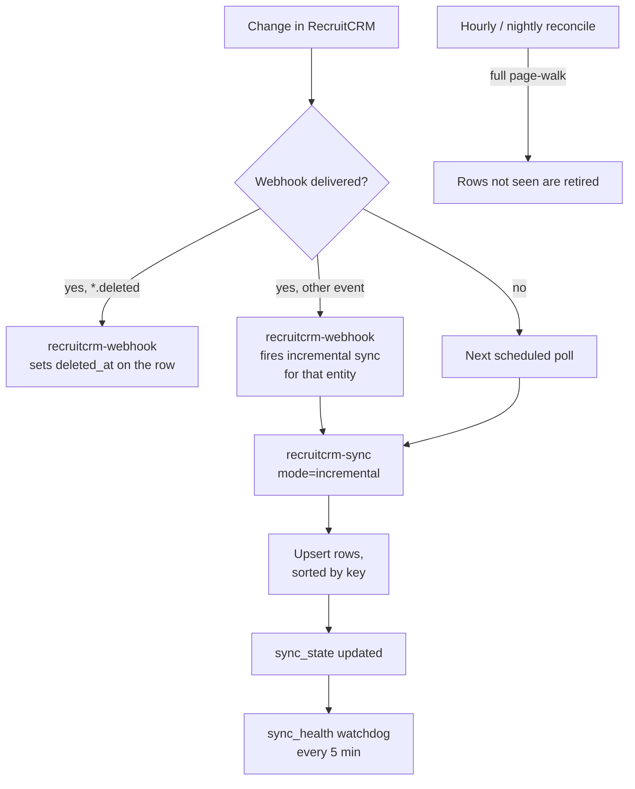
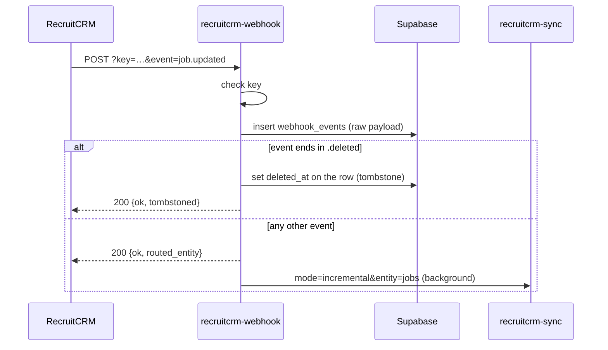

import { Tabs, TabItem, Aside, Badge, LinkCard, CardGrid } from '@astrojs/starlight/components';

For admins and developers who need to know how fresh a figure is, why a record is or is not in the mirror, or which job to look at when a feed goes stale.

**Polling is the guarantee; webhooks are the fast path.** Every entity is walked on a `pg_cron` schedule whether or not a webhook arrives, so a missed delivery delays a change but never loses it.

## How a change reaches the mirror



## What is mirrored

| Table | From RecruitCRM | Notes |
|---|---|---|
| `consultants` | Users | `recruitcrm_id` is the canonical identity. Leavers stay, marked inactive |
| `clients` | Companies | Includes the Company Status custom field (the BD funnel) |
| `contacts` | Contacts | Name, company, job title, owner. No email or phone (0145, 03/11/2026) |
| `jobs` | Jobs | Includes job custom fields (0090), so DPE scores, grades and `forecast_fee` are reportable |
| `candidates` | Candidates | Includes the off-limit flag, end date and reason |
| `candidate_stage_events` | Hiring-stage history | The single source for the whole funnel (D1) |
| `candidate_assignments` | Candidate-job assignments | From the history feed plus an hourly sweep |
| `call_activity` | Devyce call logs | Metadata and category only. No phone numbers, no call notes |
| `deals` | Deals | Billing is Won deal value. Fee components from deal custom fields (0043) |
| `meetings` | Meetings | This quarter and last |
| `notes` | Notes | Makes leads, internal interviews and job order forms countable |

Supporting tables: `stage_lookup` maps RecruitCRM's integer stage ids to `(stage_metric, stage_name)`; `sync_state` holds each feed's last run, status, cursor and error count; `webhook_events` keeps raw payloads for debugging; `audit_log` records every write.

**Deliberately not mirrored:** candidate CVs and files (read live when asked), Devyce call summaries (`call_notes` reads them live and never stores them) and email bodies.

## Sync modes

`recruitcrm-sync` is one locked function driven by query parameters. Mode defaults to a per-entity backfill.

| `mode` | What it does | Driven by |
|---|---|---|
| `incremental` | Adds and edits for consultants, clients, contacts, candidates, jobs, calls, deals and meetings, each in its own isolated step | `recruitcrm-incremental-sync`; webhooks; connector write-through |
| `history_recent` | Candidate stage history for recently changed candidates (`days`, default 2; `max_candidates`, default 120) | `history-recent` |
| `history` | Stage history walk (`max_candidates`, default 70) | Manual |
| `notes_recent` | Re-walks the newest note pages (`max_pages`, default 3). Notes have no sort parameter, so there is no cursor | `notes-recent` |
| `offlimit` | Refreshes off-limit flags | `offlimit-refresh` |
| `assignment_sweep` | Picks up assignments the history feed missed. Runs in the background | `recruitcrm-assignment-sweep` |
| `meetings_quarter` | Meetings since the start of the quarter | `meetings-quarter-refresh` |
| `reconcile` | Full page-walk of one `entity` (clients, contacts, candidates, jobs, deals, consultants) to detect deletions. Background | Reconcile jobs |
| `backfill_all` | Resumable candidate walk (`entity=candidates` only); retires unseen candidates when complete | `backfill-candidates-pass` and `-drain` |
| omitted | Backfill one `entity` from `start_page` for `max_pages`: consultants, clients, contacts, candidates, jobs, calls, deals, notes | Manual, see [Backfills](/run/runbook/#backfills-and-reconciles) |

### Behaviours worth knowing

- **One entity cannot abort the others.** Each incremental step is wrapped. On 21/08/2026 one unmirrorable candidate threw and took jobs and calls down with it for eleven days, silently, because `pg_cron` records only the HTTP post, not the 500 that came back. A failing step now writes `error:...` to its own `sync_state` row, which `sync_health()` treats as critical.
- **The watermark moves only after a complete walk.** If a walk stops early (a 429 or the page cap), it saves its place in `sync_state.cursor` and resumes there. It can re-read rows but never skip them.
- **429s are retried** up to three times, honouring `Retry-After` up to 10 seconds, otherwise backing off 1, 2 and 4 seconds (since 29/10/2026).
- **Rows are de-duplicated and sorted by key before every upsert.** RecruitCRM's paged lists can return the same record twice in one page, which fails a whole multi-row upsert. Sorting by key also gives every writer the same lock order: overlapping writers in different orders caused 42 deadlocks before 0157 (09/11/2026).
- **`service_role` has a 60-second statement timeout** (0157). Sync batches that update the candidates trigram index were hitting the 8-second default.
- **A backfill does not touch the health clock.** Otherwise a manual backfill would make a dead incremental feed look healthy, which is how the funnel sat frozen for six days on 10/08/2026.

## Schedule

All jobs are `pg_cron` and run in UTC. Jobs that must land at a UK clock time are scheduled at two UTC hours, and an `*_if_due()` wrapper lets only the run that falls in the right London hour proceed, so they survive the clock change without edits.

<Tabs>
<TabItem label="Sync">

| Job | Schedule (UTC) | What |
|---|---|---|
| `history-recent` | `*/5 * * * *` | Candidate stage events: the funnel feed. Every 5 minutes since 0152 (05/11/2026); was every minute |
| `backfill-candidates-drain` | `*/3 * * * *` | Resumes the candidate reconcile walk until complete |
| `recruitcrm-incremental-sync` | `*/15 * * * *` | Adds and edits for all entities |
| `notes-recent` | `*/15 * * * *` | Newest note pages |
| `recruitcrm-reconcile-clients` | `5 * * * *` | Deletion detection |
| `recruitcrm-reconcile-jobs` | `12 * * * *` | Deletion detection |
| `recruitcrm-reconcile-deals` | `18 * * * *` | Deletion detection |
| `offlimit-refresh` | `25 * * * *` | Off-limit flags (hourly since 25/09/2026; `/match` reads this flag) |
| `recruitcrm-assignment-sweep` | `40 * * * *` | Assignments the history feed missed |
| `recruitcrm-reconcile-consultants` | `0 3 * * *` | Deletion detection; a removed consultant triggers token auto-revoke |
| `recruitcrm-reconcile-contacts` | `20 3 * * *` | Deletion detection |
| `backfill-candidates-pass` | `40 5,18 * * *` | Starts the candidate reconcile walk, twice daily outside working hours |
| `meetings-quarter-refresh` | `10 6 * * *` | Meetings, this quarter and last |
| `inbox-poll` | `*/5 * * * *` | `inbox-sync`: connected Outlook inboxes |

</TabItem>
<TabItem label="Monitoring and housekeeping">

| Job | Schedule (UTC) | What |
|---|---|---|
| `sync-health-watchdog` | `*/5 * * * *` | `check_sync_health()`: alerts on a stale or failing feed |
| `cron-manifest-watchdog` | `*/10 * * * *` | `check_cron_manifest()`: alerts if a declared job is missing, inactive or rescheduled |
| `purge-cron-history` | `15 3 * * *` | Keeps 3 days of `cron.job_run_details` |
| `inbox-retention` | `20 3 * * *` | Deletes inbox envelopes older than 30 days |
| `purge-webhook-events` | `45 3 * * *` | Keeps 3 days of `webhook_events` (7 until 0151, 05/11/2026) |
| `vacuum-http-response` | `30 4 * * 0` | Weekly `vacuum full` of `net._http_response`, which `pg_net` never shrinks (0152) |
| `sync-health-digest` | `30 7 * * *` | Daily health summary. One UTC hour only, so 07:30 UK in winter, 08:30 in summer |

</TabItem>
<TabItem label="Slack">

| Job | Schedule (UTC) | Lands at (UK) | What |
|---|---|---|---|
| `coach-monday` | `45 7,8 * * 1` | 08:45 Mondays | Coach: the week ahead |
| `coach-midday` | `30 11,12 * * 1-5` | 12:30 weekdays | Coach: today so far |
| `coach-wrap` | `45 15,16 * * 1-5` | 16:45 weekdays | Coach: admin before home time, call tagging |
| `weekly-usage-slack` | `0 15,16 * * 5` | 16:00 Fridays | Usage table, via `weekly_usage_post_if_due()` |

</TabItem>
</Tabs>

This is the live `cron.job` table as of 09/11/2026: 25 jobs.

### The cron manifest

`cron_manifest` declares every job that should exist, with its schedule and a note. `check_cron_manifest()` compares it with `cron.job` and alerts on drift. It exists because on 10/09/2026 the sync jobs vanished and nobody noticed for five days: the watchdog had gone with them.

```sql
-- do the jobs still exist, active and on schedule?
select public.check_cron_manifest();

-- what is declared against what is scheduled
select j.jobname, j.schedule, j.active, m.jobname is not null as declared
from cron.job j full join public.cron_manifest m using (jobname)
order by 1;
```

<Aside type="caution" title="Change both in the same migration">
Any migration that adds, removes or reschedules a permanent job must update `cron_manifest` too, or the watchdog alerts on the drift. One-off jobs that unschedule themselves (like 0150's go-live switches) stay out of the manifest.
</Aside>

<Aside type="caution" title="The candidate reconcile is a pair">
`backfill-candidates-pass` resets the cursor and starts a walk; `backfill-candidates-drain` resumes it every 3 minutes until done, when `retire_unseen_candidates` runs. Neither works alone. Restoring the pass without the drain on 15/09/2026 made the walk restart forever.
</Aside>

## Webhooks

RecruitCRM pushes change notifications to `recruitcrm-webhook`. The function is a **"something changed, sync now"** trigger, not a data source: it logs the payload, works out the entity and fires `recruitcrm-sync?mode=incremental&entity=...`. Admins manage subscriptions with the `webhook_subscriptions` tool.



1. **RecruitCRM never names the event in the body.** None of the first 1,973 events carried an event field. Octagon chooses each subscription's `target_url`, so the event name rides on the URL (`?event=job.deleted`).
2. **Routing is by event name, then by record shape.** The original router keyword-scanned the body; job payloads contain `note_for_candidates`, so on 15/09/2026, 68 job and 16 company payloads had been routed to candidates. It now trusts `?event=` and falls back to distinctive top-level keys (`deal_stage`, `job_status`, `company_name`, `call_type`, `first_name`).
3. **Deletions are tombstoned, not synced.** The incremental walk only sees records that still exist, so a delete would otherwise wait up to an hour for a reconcile.

| Event prefix | Routed to | On `.deleted` |
|---|---|---|
| `candidate.` | `candidates` | `candidates.deleted_at` by `slug` |
| `job.` | `jobs` | `jobs.deleted_at` by `slug` |
| `company.`, `contact.` | `clients` | `clients.deleted_at` by `company_slug` (company only) |
| `deal.` | `deals` | `deals.deleted_at` by `slug` |
| `calllog.` | `calls` | no tombstone |

A sample successful delivery response:

```json
{ "ok": true, "routed_entity": "jobs", "event": "job.updated" }
```

and a delete:

```json
{ "ok": true, "event": "candidate.deleted", "slug": "<candidate-slug>", "tombstoned": 1 }
```

A `GET` with a valid key returns `{"ok":true,"service":"recruitcrm-webhook"}` and is used as a health ping.

## Reconciles and tombstones

Reconciles are full page-walks, because walking every record is the only way to spot a deletion by polling. They are staggered at :05, :12 and :18 past the hour so they do not contend.

- A record not seen in a complete walk is soft-deleted: its `deleted_at` is set, so history and foreign keys survive. A row that reappears in RecruitCRM is restored. Nothing is hard-deleted.
- `reconcile_entity()` refuses to run on an empty set of live ids, so a failed fetch can never wipe a table.
- **Deleted records are hidden from operational views and kept in historical counts.** Deleting a candidate does not change last quarter's CV sends.
- A reconcile that skips or stops early is recorded as **degraded** (0134), so it shows as `warn` rather than silently passing.
- When `reconcile-consultants` marks someone inactive or deleted, the leaver trigger (0136) switches off their tokens and inbox polling. See [Security](/run/security/#tokens-and-revocation).

## Sync health

```sql
select public.sync_health();
```

Returns an overall status and one row per feed (18 as of 09/11/2026), each `ok`, `warn` or `critical` with a reason. These are the thresholds in the live function:

| Feeds | Warn after | Critical after |
|---|---|---|
| Live: candidates, clients, contacts, consultants, jobs, calls, deals, inbox | 20 min | 45 min |
| `history_recent`, notes, meetings | 25 min | 60 min |
| Off-limit; reconciles of clients, jobs, deals | 2 h | 4 h |
| Candidate reconcile (`backfill:candidates`) | 14 h | 18 h |
| Contacts reconcile | 25 h | 48 h |

- **Two failed runs in a row go critical** whatever the age (0124).
- On the strict live feeds, an error status goes critical once the next scheduled run has also failed.
- **Degraded** runs finished but did nothing useful: stopped by a 429, partial, cut short by the page cap, a reconcile that skipped, a possibly truncated off-limit list, or an inbox poll reporting `error` or `not_configured` (0149).

Alerts from `check_sync_health()` and `check_cron_manifest()` go to `alert_webhook_url` in `app_settings` (the analytics-admin bot). They fire on transitions and re-alert a still-critical feed every 6 hours. Admins can see the same picture in Claude with `/health` (the `platform_health` tool).

<CardGrid>
	<LinkCard title="Runbook: backfills" href="/run/runbook/#backfills-and-reconciles" description="Calling recruitcrm-sync by hand, safely." />
	<LinkCard title="Funnel caveats" href="/use/data-caveats/" description="Why parity with RecruitCRM's own report stops at about 0.4%." />
</CardGrid>
