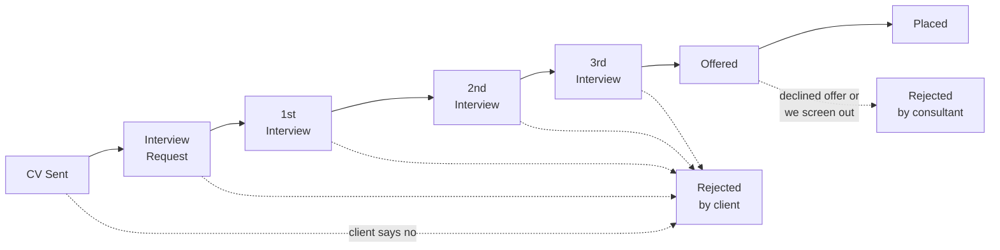

import { Card, CardGrid, LinkCard, Steps } from '@astrojs/starlight/components';
import Example from '../../../components/Example.astro';

For recruiters and managers reading `/funnel`, `/leaderboard` or the dashboard funnel. It answers what each stage counts, who gets the credit, which ratios matter, and why the numbers can differ very slightly from RecruitCRM's report.

## The stages

The funnel always runs in this order: **CV Sent → Interview Request → 1st → 2nd → 3rd → Offered → Placed**. Shortlist exists in RecruitCRM but only some desks use it, so it is not the top of the funnel and never a denominator.

:::note[Rejections can happen at any stage]
The diagram shows the two kinds of rejection. "Rejected by client" means the client turned the candidate down; "rejected by consultant" means we screened them out ourselves, which includes declined offers. Client rejection rate = rejected by client ÷ CVs sent.
:::

## How a stage is counted

<Steps>

1. **Source.** Every count comes from RecruitCRM's hiring-stage history, the record of each time a candidate moved stage on a job. Deal stages and other activity are never blended in.
2. **One pair, once.** A stage counts **distinct candidate-job pairs**. A candidate moved to 1st Interview twice on the same job counts once.
3. **At the last entry.** The pair is counted at the **last** time it entered that stage, which decides which window and which person it falls in.
4. **Credited to the mover.** The credit goes to whoever made that stage move, not the job owner. Leavers keep theirs, tagged "left".

</Steps>

### Why the mover, not the job owner

Crediting the person who made the move matched RecruitCRM's January report on 20 of 27 per-consultant figures. Crediting the job owner gave people credit for work on jobs they inherited later. Desk views (cold jobs, stalled, time to fill) still go to the job owner, because the desk is whoever owns the role now.

:::tip[A worked case]
[Candidate] goes to CV Sent on [Job] in March, sent by Keelan. In May, after the role is reopened, Adam sends the CV again. The pair counts **once**, as a May CV send, credited to Adam.
:::

## The named ratios

A rate on its own is meaningless, so every rate names its ratio and goes to 1 dp.

| Ratio | Reads as |
|---|---|
| CV→interview request | Share of CVs that got an interview request |
| CV→1st interview | Share of CVs that got to a first interview |
| 1st interview→offer | Share of first interviews that became offers |
| CV→placed | Share of CVs that ended in a placement |

Ratios are the point, not volumes. A desk sending 300 CVs at 1% is not outperforming one sending 100 at 4%.

<Example ask="/funnel Q3" who="Recruiter">
The window stated as DD/MM/YYYY, the seven stage counts in order, then the four ratios: CV→interview request x.x%, CV→1st interview x.x%, 1st interview→offer x.x%, CV→placed x.x%. Then a per-consultant table, highest CV sends first.
</Example>

<Example ask="/funnel the tech team last month" who="Manager">
The same layout scoped to the team and window, with each consultant's row so you can compare ratios rather than volumes.
</Example>

<Example ask="/rejections Keelan Riley last quarter" who="Manager">
Client rejections against our own screening, and the client rejection rate (rejected by client ÷ CVs sent). Look at the client breakdown before the consultant breakdown: a high rate can mean wrong candidates, a poor brief or a hard client.
</Example>

## Matching RecruitCRM's report

The funnel reads RecruitCRM's API, not its candidate lifecycle report. Measured on 08/09/2026 across five months:

<CardGrid>
	<Card title="~0.4% total variance" icon="analytics">
		30 rows in 7,935, across 50 stage-months.
	</Card>
	<Card title="34 of 50 exact" icon="approve-check">
		Offered, Placed, 2nd and 3rd Interview were exact in every month tested.
	</Card>
	<Card title="Where the gap sits" icon="magnifier">
		Shortlist, CV Sent and Rejected - Consultant only.
	</Card>
</CardGrid>

The gap is between RecruitCRM's API and its own report: the report leaves out rows the API returns, for live, unmerged, undeleted candidates. Every rule that closed the gap broke a stage that was exact, so the API is treated as the truth and the last 0.4% is not chased (decided 08/09/2026).

:::caution[Before 2026]
RecruitCRM's hiring-stage history thins out badly before 2026, which is why reports default to 2026 year to date. Comparisons across that boundary are not like-for-like.
:::

### Shortlist

Shortlist is partly adopted: 1,948 shortlisted pairs against 3,009 CVs sent in 2026 (as of 04/11/2026). Some desks skip straight to CV Sent, so a shortlist→CV rate means nothing.

## Placed is not billed

A move to Placed is a placement in the funnel. It carries no fee. Billing happens when the deal is moved to Won with the value entered ([`/won`](/use/commands/#won)), and the deal owner gets the credit. Moving to Placed through Claude needs the candidate's start date. See [Metrics: money](/use/metrics/#money).

<CardGrid>
	<LinkCard title="Metrics and definitions" href="/use/metrics/" description="Attribution, money and every other figure." />
	<LinkCard title="Data caveats" href="/use/data-caveats/#funnel-parity-with-recruitcrms-report" description="The parity measurement in context." />
</CardGrid>
