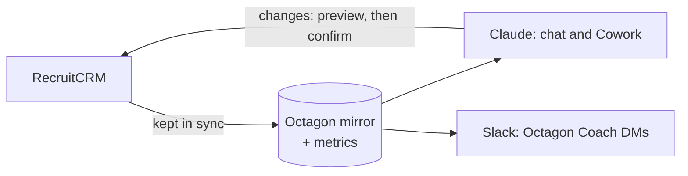

import { Card, CardGrid, LinkCard, Steps } from '@astrojs/starlight/components';
import Example from '../../../components/Example.astro';
import platform from '../../../data/platform.json';

For a recruiter starting on Octagon Analytics. It covers getting connected (about fifteen minutes, once), the three things that look broken on day one but aren't, and what to do in your first week.

## What you are connecting to

Octagon Analytics is live recruitment analytics on top of RecruitCRM, with Claude as the way in. You ask questions in plain English or with a slash command, and Claude answers from the same definitions the dashboard uses, so the two never disagree. RecruitCRM stays the system of record: when you change something through Claude, it is written to RecruitCRM as you.

<CardGrid>
	<Card title="Ask" icon="comment">
		Questions about your desk, your clients and the firm. {platform.commandCount} slash commands, or plain English.
	</Card>
	<Card title="Act" icon="pencil">
		Move stages, add notes, raise deals, draft emails. Every change previews first and waits for you.
	</Card>
	<Card title="Get nudged" icon="rocket">
		"Your day" at the start of each chat, the action queue, and for some, the Octagon Coach in Slack.
	</Card>
</CardGrid>

## Get connected

<Steps>

1. **Get your access token.** Ask Ollie to mint you one. It maps to **you**: your figures are scoped to your desk, and anything you change in RecruitCRM is attributed to your name, not a shared account. Treat it like a password: never paste it into a chat, ticket or shared doc.

2. **Add the connector.** It may already be set up for the whole organisation; if so, just enable it and sign in. Otherwise, in claude.ai (web or desktop):
   - Settings → Connectors → Add custom connector
   - Name: `Octagon Analytics`
   - URL: `https://kzcmssldvtjnbwwunuwm.supabase.co/functions/v1/octagon-mcp`
   - Connect. Claude opens Octagon's **Connect your account** page. Paste your token and press **Authorize**. You are sent straight back to Claude.

   If the page says the token wasn't recognised, check you pasted all of it, or ask Ollie for a new one.

3. **The plugins arrive on their own.** The slash commands come from four Octagon plugins, published org-wide, so there is nothing to install. See the table below for who gets which.

4. **Turn auto mode on (Cowork).** Without it you approve every step individually, which turns a ten-second answer into a dozen clicks. Changes to RecruitCRM still stop for your confirmation either way.

5. **Check it worked.** Start a new chat and say **dashboard**. You should see **Your desk** with your name and your own numbers.

</Steps>

### What is set on your token

| Setting | What it controls |
|---|---|
| Write access | Whether you can change anything in RecruitCRM at all |
| Admin | Whether you see the whole team or just your own desk. Recruiters see their own |
| Usage viewer | Whether you can see team usage views without full admin |

### Which plugins you get

| Plugin | Who gets it | What it holds |
|---|---|---|
| octagon-reporting | Everyone | Read-only reporting, lookup, writing aids and your day |
| octagon-dashboard | Everyone | The inline dashboard and `/kpi` |
| octagon-actions | Only people who should write to RecruitCRM | Every command that changes a record |
| octagon-admin | Managers and admins | Team views, usage, tokens |

The full list is on [Commands](/use/commands/).

### If the check fails

| What you see | What it means |
|---|---|
| A whole-team view instead of **Your desk** | Your token is resolving as an admin. Tell Ollie |
| An authentication error | Token wrong or revoked. Ask Ollie for a new one |
| Nothing happens | The connector isn't enabled in that chat |
| A command you expected is missing | A connector release added it: reconnect, or start a new chat |

:::note[What admins can see about your use]
Admins can see how each person uses the platform: which features, how often, and what kind of change was made (for example "3 stage moves"). Not which candidate, and not what you wrote. Chats that don't use the connector aren't counted. It exists to help people get set up, not to measure performance.
:::

## Before you trust a number

Three things look broken on day one and aren't.

<CardGrid>
	<Card title="BD and client calls look low" icon="warning">
		They count only Devyce calls that have been tagged with a category, and most aren't. Run `/tagcalls` and they become real. See [KPIs and targets](/use/kpis-and-targets/#how-calls-are-counted).
	</Card>
	<Card title="Monday morning reads 0" icon="information">
		The KPI week runs Monday to Sunday. A fresh week genuinely is 0 of 10 CV sends. Early-week gaps are expected.
	</Card>
	<Card title="Shortlist looks thin" icon="information">
		Only some of the desk use that stage, so it isn't the top of your funnel. The funnel starts at CV Sent. See [The funnel](/use/funnel/).
	</Card>
</CardGrid>

The weekly minimums are 10 CV sends, 5 interview requests, 4 interviews, 5 BD calls and 5 client calls. The full list of soft spots is on [Data caveats](/use/data-caveats/).

## Your first week

### The five commands to learn first

| Command | When | What you get |
|---|---|---|
| [`/myday`](/use/commands/#myday) | First thing | Interviews to prep, feedback due, aging offers, stalled candidates, cold roles, plus one command worth trying today |
| [`/queue`](/use/commands/#queue) | Morning | Today's ranked calls, with the admin for each drafted for you to check |
| [`/chase`](/use/commands/#chase) | Mid-morning | What to chase across your whole pipeline, in priority order |
| [`/week`](/use/commands/#week) | Any time | This week against every KPI target, with the gap named |
| [`/eod`](/use/commands/#eod) | End of day | Today on all five KPIs in one table, against where the week needs to be |

You don't need command syntax. "What's my day?", "how am I doing this week?" and "prep my queue" work just as well. Type `/` to see the rest.

<Example ask="what's my day?" who="Recruiter">
A short standup, most urgent first: interviews today and tomorrow to prep for, feedback due on interviews already held, aging offers, stalled candidates and cold roles, each with the single next action. Any weekly KPI you are behind on, with the gap as a number. It can end with one line such as "Try today: `/silver` — why", picked from your own records.
</Example>

### A practical week

| Day | Do this |
|---|---|
| Monday | Connect. Say **dashboard**, then `/myday`. Run `/tagcalls` on last week's calls so your BD and client numbers are real |
| Tuesday | Start from `/queue` and work the list |
| Wednesday | Pick a live role: `/pipeline` for who's in play, `/coldjobs` for roles with no activity in 7 days, `/silver` for interview-tested candidates to put forward |
| Thursday | Content on a real role: `/advert`, `/boolean`, `/match`. Missing details come back as `[placeholders]`, never invented |
| Friday | `/week` to see the gap, `/eod` before you finish. If you have write access, `/pushtell` drafts your client updates |

<Example ask="/tagcalls this week" who="Recruiter">
A numbered list of your untagged calls of 30 seconds or more, contact calls first: time, who, company, minutes, and a **suggested** category with the reason. You accept all, some, or change any ("3 is BD"). Claude previews the tags and applies them only when you say yes. Afterwards it tells you where you now stand on BD and client calls for the week.
</Example>

## Ground rules

1. **RecruitCRM is the system of record.** Changes go there through Claude, never through the RecruitCRM website in a browser. If no command can make a change, Claude says so and gives you the manual step.
2. **Every change is previewed first** and applied only when you confirm. See [Making changes safely](/use/making-changes/).
3. **Candidate names and notes are PII.** Internal only. Never pasted into a client email unless already shared with that client. No bulk export.
4. **Drafts, not sends.** Read every email, InMail and pitch before it leaves you. Spec pitches stay anonymised until the client engages, and off-limit candidates are never pitched or emailed.
5. **It will tell you when it can't answer.** "That isn't tracked" is the system working, not failing. Ask "where does that number come from?" to get the definition.

## Something not working?

Post in #troubleshooting, or message Ollie, with what you asked, what you expected and what you got. Screenshots help. The **Report an issue** link on the connect page reaches Ollie too.

<CardGrid>
	<LinkCard title="Your day" href="/use/your-day/" description="My day, /dayplan, /queue, /chase and the Octagon Coach." />
	<LinkCard title="Asking questions" href="/use/asking-questions/" description="What you can ask, grouped by what you are trying to do." />
</CardGrid>
