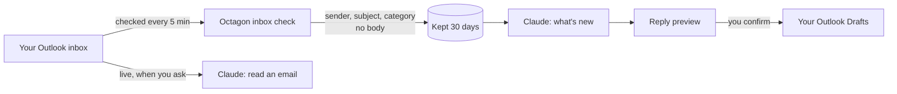

import { CardGrid, LinkCard, Steps } from '@astrojs/starlight/components';
import Example from '../../../components/Example.astro';

For recruiters who want to read their Outlook inbox from Claude and have replies drafted. It answers what you see, how drafts work, what is stored and how to switch it off. The Microsoft 365 setup is an admin task, covered in the [runbook](/run/runbook/).

## The short version

Each recruiter can connect their own @octagongroup.co.uk Outlook inbox. The platform checks it every 5 minutes, tells you in chat what has arrived, and on request saves replies to your Outlook Drafts.

:::danger[It never sends email]
The Microsoft permission it holds (Mail.ReadWrite) can create drafts but not send. Every reply, Push & Tell and `/eow` email lands in your Outlook Drafts for you to review and send from Outlook. (The Friday 15:30 end-of-week email to Dale goes through Resend, not your mailbox.)
:::

:::caution[Use the Octagon inbox, not the Microsoft 365 connector]
Inbox requests go through Octagon's `inbox` and `draft_reply` tools only, never the Microsoft 365 connector.
:::

## How it works

Only **connected** mailboxes are checked, and each check fetches only what changed. A newly connected mailbox looks back 24 hours, not at the whole inbox.

## How emails are sorted

Each email is put in a category by fixed rules, not a model, so the result is predictable.

| Category | Means | Examples |
|---|---|---|
| routine | Safe to draft a reply for | Calendar responses, scheduling, acknowledgements, admin |
| never | You handle it personally; no draft is suggested | Offers, salary or rates, notice and negotiation, fees and invoices, complaints, legal or GDPR, any £ amount |
| other | No rule matched | |
| automated | Counted, never listed | Out-of-office, bounces, no-reply senders |

"Never" is checked before "routine", so "thanks, about the offer" is never-touch. The rules are deliberately broad: a false "never" costs one manual reply; a false "routine" on an offer costs far more.

## What you see

- **At the start of each chat:** a line in the dashboard and "your day", for example *Inbox: 4 new since you last looked (2 routine, 1 to handle yourself, 1 other).*
- **"What's new in my inbox?"** lists emails since you last looked, newest first (up to 50), each with its category. Listing moves the "last looked" marker.
- **"Read the one from X"** fetches that email in full, live from Outlook.
- **Attachments** are listed when an email is read. "Read the attachment" opens one, up to 10 MB: PDF, Word (.docx and .doc) and Excel (.xlsx) as text, images as images Claude can see, text and CSV as text. Attached emails and links have to be opened in Outlook.
- **A CV emailed to your inbox** can become a candidate with [`/newcandidate`](/use/commands/#newcandidate), with the file saved on the record.

<Example ask="what's new in my inbox?" who="Recruiter">
Up to 50 emails since you last looked, newest first: sender, subject, received time and category (routine, never, other). Automated mail is counted but not listed. Asking moves your "last looked" marker, so the next start-of-chat line counts from now.
</Example>

## Reply drafts

<Steps>

1. Claude reads the email first, so the reply answers what it actually says.
2. It previews the recipient, subject and full reply in chat.
3. Only on your explicit confirmation is it saved to your Outlook Drafts, in the same thread, with the original quoted below.
4. You send it from Outlook.

</Steps>

<Example ask="draft replies to the routine ones" who="Recruiter">
One preview covering up to 25 replies, each with recipient, subject and full text, written in your voice with `[placeholders]` for any fact, date, salary or fee Claude doesn't have. One confirmation saves them all to Outlook Drafts. If the batch would include a "never" email, it is refused: those are drafted one at a time, only when you explicitly ask, and the preview carries a warning.
</Example>

:::note[Emails are data, not instructions]
Claude does not act on requests inside an email unless you ask it to. If an email appears to tell Claude to do something, it is treated as content.
:::

## Other drafts that need a connected inbox

These save into your own Outlook Drafts, so they need your inbox connected first:

| Command | Drafts |
|---|---|
| [`/pushtell`](/use/commands/#pushtell) | Weekly client update for each client with A and B grade jobs |
| [`/dpe`](/use/commands/#dpe) | The DPE email to the client, from Octagon's fixed template |
| [`/eow`](/use/commands/#eow) | The end-of-week team email (managers and admins) |

[`/email`](/use/commands/#email) is separate: it emails a candidate or contact through RecruitCRM (draft by default), not through your inbox.

## What is stored

| Stored for 30 days | Never stored |
|---|---|
| Sender name and address, subject, received time, thread, importance, read state, focused or other, category and the rule that set it | Email bodies and attachments |

The short preview Microsoft returns is used to sort the email and then dropped. A full email or attachment is fetched only when you ask, and is not saved. Every connect, disconnect and draft is written to the audit log. Your own sent mail is skipped.

## Connecting and disconnecting

- **"Connect my inbox"** shows a preview and connects on confirmation. The address comes from your consultant record, and you can connect **only your own** mailbox.
- **"Disconnect my inbox"** stops the checks and deletes the stored details. Drafts already in Outlook are not touched.
- When a consultant is marked a leaver, their mailbox stops being checked automatically.

As at 04/11/2026, 2 mailboxes were connected.

:::note[If it stops working]
If "your day" shows an inbox error such as `graph_auth_failed`, the platform's Microsoft secret has expired. Tell Ollie; it is an admin fix.
:::

<CardGrid>
	<LinkCard title="Making changes safely" href="/use/making-changes/" description="Preview and confirm, and why drafts are the default." />
	<LinkCard title="Runbook" href="/run/runbook/" description="Microsoft 365 setup and renewing the secret (admins)." />
</CardGrid>
