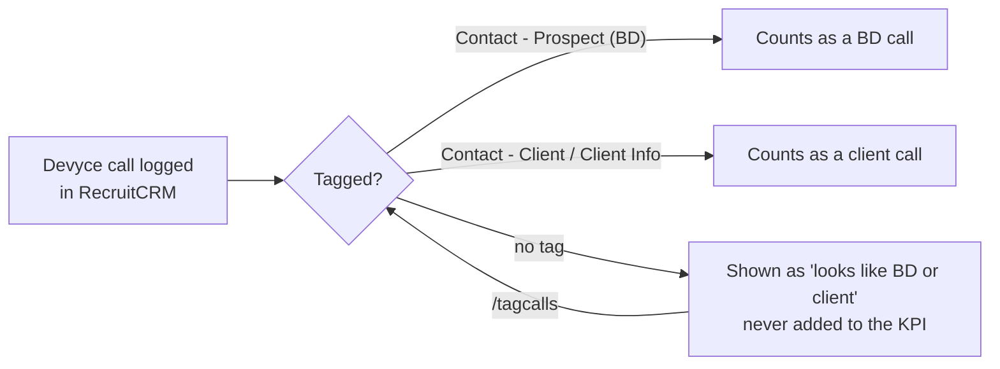

import { Card, CardGrid, LinkCard } from '@astrojs/starlight/components';
import Example from '../../../components/Example.astro';

For recruiters and managers. It answers what you are measured on each week and each quarter, how each KPI is counted, and why BD and client calls read low until you tag them.

## The short version

<CardGrid>
	<Card title="Weekly: five KPIs" icon="list-format">
		10 CV sends, 5 interview requests, 4 interviews, 5 BD calls, 5 client calls. Monday to Sunday, per recruiter.
	</Card>
	<Card title="Quarterly: billing" icon="analytics">
		Won deal value against your quarterly billing target. Pipeline is the forward indicator, never added in.
	</Card>
</CardGrid>

Early-week gaps are expected: a fresh Monday genuinely is 0 of 10 CV sends.

## The weekly KPIs

| KPI | Weekly minimum | What counts | Credited to |
|---|---|---|---|
| CV sends | 10 | Candidates moved to CV Sent this week | Whoever made the move |
| Interview requests | 5 | Moves to Interview Request | Whoever made the move |
| Interviews | 4 | Moves to 1st Interview | Whoever made the move |
| BD calls | 5 | Devyce calls tagged `Contact - Prospect (BD)` | The caller |
| Client calls | 5 | Devyce calls tagged `Contact - Client` or `Contact - Client Info` | The caller |

Placements are reported with no weekly target: billing is quarterly.

<Example ask="/week" who="Recruiter">
An inline scorecard from Monday (stated as DD/MM/YYYY): each KPI's actual against target. Claude adds only the headline and the exceptions: anyone behind with the gap as a number and one next action, then anyone ahead worth noting. Where you have a plan from billing, "behind" is judged against your plan, and it says which step to work on (for example CV→interview request) and where the quarter stands.
</Example>

## Your weekly plan

The minimums above are the floor. If you have a quarterly billing target, your **plan** works your weekly CVs, interview requests and interviews back from it:

- **Run-rate, not catch-up.** The target is spread over 13 weeks. The quarter's position is shown alongside, but the plan does not spike late (a CV sent in December rarely bills by 31/12).
- **Your own ratios**, over the last 6 months, blended towards the firm's when your sample is small. Your median fee from your Won deals in 12 months, or the firm's if you have fewer than 4.
- **Never below the flat minimums** (10 CVs, 5 interview requests, 4 interviews).
- **No billing target, no plan from billing:** you get the minimums, and the Coach says so.

The plan arrives in the Coach's Monday 08:45 DM; Friday's end-of-week email compares actuals with it. The Coach also uses "today's share" (plan ÷ 5, rounded up) and "pace" (plan × days so far ÷ 5). See [Your day](/use/your-day/#the-octagon-coach-in-slack).

## Quarterly billing

| Term | Means |
|---|---|
| Billing | The value of your **Won** deals with a close date in the quarter, credited to the deal owner. Start inclusive, end exclusive, UK time |
| Won to date / Won later this quarter | Billing split by whether the close date is on or before today |
| Target | Set per recruiter. Anyone without one shows as **TBC** |
| Pipeline | Deals at Open through Offered. The forward indicator, not billing |

:::caution[Placed is not billed]
A candidate at Placed carries no fee. Billing happens when the deal is moved to Won with the value entered, using [`/won`](/use/commands/#won). This is the most common reason a desk feels ahead of what the number shows.
:::

<Example ask="/billing" who="Recruiter">
Won revenue this quarter against your target and the gap, pipeline in play as a separate line, and all-time Won for context, in £ with separators (for example £xx,xxx of £xx,xxx). If you are behind, the nearest deal that would close the gap. Pipeline is never added to Won, and invoices are not tracked.
</Example>

Full money definitions are on [Metrics](/use/metrics/#money).

## Other things that are measured

These count **what was logged**, not what happened. A low number can mean low activity or low recording.

| Measure | Where it lives | Ask with |
|---|---|---|
| Leads | Notes typed `Lead` | [`/noteskpi`](/use/commands/#noteskpi) |
| Internal interviews | Notes typed `Candidate - Internal Interview` | [`/noteskpi`](/use/commands/#noteskpi) |
| Job order forms (JOFs) | Notes typed `Job Order Form Complete` | [`/noteskpi`](/use/commands/#noteskpi), [`/newjobs`](/use/commands/#newjobs) |
| Pitches | RecruitCRM's pitch feature | [`/pitches`](/use/commands/#pitches) |
| Client visits | Meetings typed **Client Meeting**. Minimum 2 per consultant per quarter | [`/visits`](/use/commands/#visits), [`/visitplan`](/use/commands/#visitplan) |

:::note[Getting these to count]
- **Leads:** `/note` can file a note as an internal interview (on a candidate) or a job order form (on a job), but **not as a lead**. To register a lead, set the note type in RecruitCRM itself.
- **Pitches:** `/specpitch` writes a pitch but doesn't record it. Record it with `/pitch`, or the pitch count under-reports.
- **Client visits:** a meeting with no type can't count. `/visitplan` and "your day" offer to type them.
:::

## How calls are counted

BD and client call KPIs count **only Devyce calls that have been tagged** with a category. An untagged call to a client doesn't count, however good it was.

Most calls are not tagged: about 12% of all calls in October 2026. Calls of 30 seconds or more to client contacts are tagged more often (26.0% in October 2026), but even so, a recruiter making ten real BD calls records two or three. The detail is on [Data caveats](/use/data-caveats/#call-categorisation).

### "Looks like" counts

`/week`, `/eod` and the Coach show, beside the tagged count, how many untagged calls this week (30 seconds or more, to a client contact) **look like** BD or client calls. The guess uses, in order: how that contact's earlier calls were tagged; the company's status (Client → client call; Prospect, Engaged or Passive → BD call); a job at the company in the last 18 months (→ client call); otherwise BD. It agreed with recruiters' own tags on 84% of 1,654 tagged calls, so it is a prompt to tag, **never added to the KPI**.

### /tagcalls

<Example ask="/tagcalls yesterday" who="Recruiter">
A numbered list of yesterday's untagged calls of 30 seconds or more, contact calls first: time, who, company, minutes, and a suggested category with the reason. You accept all, some, change any ("3 is BD") or skip. Claude previews up to 25 at a time and applies only what you accepted, reads each back from RecruitCRM, then tells you where you stand: for example "BD calls x of 5".
</Example>

The categories: Contact - Client · Contact - Client Info · Contact - Prospect (BD) · Interview Feedback · Candidate - Interview Prep/Other · Candidate - Job Pitch / Qualifying · Voicemail/No Answer.

Nothing is tagged automatically, because numbers are shared and some people are both candidates and clients: only you know what the call was. If you're in the Coach pilot, the 16:45 DM offers one-press tagging of today's client-contact calls.

:::tip[Before a 1:1]
Run `/tagcalls` before `/eod`. If the "looks like" calls would close your gap, tagging them is the quickest win.
:::

## For managers

`/exceptions` lists only people with something to act on:

| Exception | Rule |
|---|---|
| Off plan | Last full week below half their plan on **both** CVs and interviews |
| Backlog | 25+ calls on their queue today, or 3+ stages out of date |
| Ratios falling | CV→interview or interview→offer over the last 8 weeks more than 30% below the previous 6 months, with enough volume |
| Client visits | Done plus booked below the pace for 2 per quarter, from week 4 |

:::caution[Coach off call numbers carefully]
Never coach off a BD or client call number without that person's tagging rate beside it. The busiest desks have tagged least. Leave isn't in RecruitCRM either, so a week off reads like a bad week.
:::

<CardGrid>
	<LinkCard title="Metrics and definitions" href="/use/metrics/" description="Every figure, its definition and who gets the credit." />
	<LinkCard title="Data caveats" href="/use/data-caveats/" description="Where the numbers are soft, and why." />
</CardGrid>
