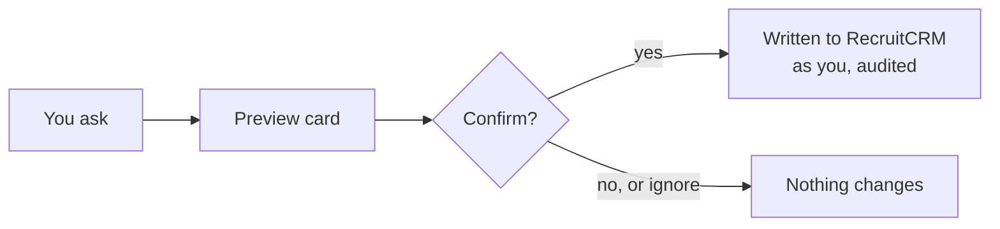

import { Card, CardGrid, LinkCard } from '@astrojs/starlight/components';
import Example from '../../../components/Example.astro';

For recruiters and managers with write access. It answers how a change gets from your request into RecruitCRM, why every change stops for your confirmation, and which actions can't be undone.

## The short version

Every change is **two-step**: you ask, Claude shows a preview of exactly what will change, and only when you press **Confirm** on the card or say yes does it touch RecruitCRM. The change is made as you, written to the audit log, and your figures update straight away.

You need two things to make changes: a token with **write access**, and the **octagon-actions** plugin. Without them, Claude can read but not change anything.

## What counts as a change

Everything that writes to RecruitCRM or your Outlook Drafts previews first. That includes:

| Area | Commands |
|---|---|
| Candidates on jobs | [`/move`](/use/commands/#move), [`/assign`](/use/commands/#assign), [`/unassign`](/use/commands/#unassign) |
| Records | [`/newcandidate`](/use/commands/#newcandidate), [`/editcandidate`](/use/commands/#editcandidate), [`/newjob`](/use/commands/#newjob), [`/editjob`](/use/commands/#editjob), [`/client`](/use/commands/#client) |
| Deals and billing | [`/newdeal`](/use/commands/#newdeal), [`/won`](/use/commands/#won) |
| Notes, tasks, meetings | [`/note`](/use/commands/#note), [`/task`](/use/commands/#task), [`/meeting`](/use/commands/#meeting) |
| BD | [`/pitch`](/use/commands/#pitch), client status changes |
| Grading | [`/dpe`](/use/commands/#dpe) |
| Lists | [`/hotlist`](/use/commands/#hotlist), [`/offlimit`](/use/commands/#offlimit) mark or release |
| Calls | [`/tagcalls`](/use/commands/#tagcalls) |
| Email | [`/email`](/use/commands/#email), [`/pushtell`](/use/commands/#pushtell), inbox replies |
| Deletes | [`/delete`](/use/commands/#delete) |

## The confirm card, in plain words

When Claude previews a change, the server issues a one-time code with it (the "card nonce"). Your confirm only works if it answers that exact preview:

- **Same change.** The confirm must be for the same tool, the same person and the same details as the preview. Change anything and you get a new preview.
- **Once only.** A code can't be reused or made up, so a change can't be applied twice.
- **Within 24 hours.** An old preview can't be confirmed later.
- **Up to 25 records.** One confirmation covers at most 25 records (calls, meetings, contacts, replies). Bigger jobs are split.

:::tip[Read the preview, then confirm]
For a stage move, the preview shows the candidate, the job, the current stage and the new stage. If something looks wrong, say no: nothing changes.
:::

<Example ask="/move [Candidate] to 1st Interview on [Job]" who="Recruiter">
A preview card: [Candidate], [Job] at [Client], current stage, new stage. The move is checked against off-limit live in RecruitCRM. You press **Confirm** or say yes. If someone else moved the candidate after the preview was made, the move is refused rather than overwriting their change.
</Example>

## Rules on particular changes

<CardGrid>
	<Card title="Moving to Placed" icon="approve-check">
		Needs the candidate's start date. Placed carries no fee: billing happens when the deal is moved to Won with `/won`.
	</Card>
	<Card title="Closing a job or losing a deal" icon="question-circle">
		Asks why. Pick a reason or skip it. Optional, but it is the only way "why do we lose" becomes answerable.
	</Card>
	<Card title="DPE scores" icon="pencil">
		You give all six scores and choose the Job Grade. Claude never fills in a score or picks a grade for you.
	</Card>
	<Card title="Call tagging" icon="phone">
		Claude suggests a category; only the ones you accept are applied. Numbers are shared and some people are both candidates and clients.
	</Card>
</CardGrid>

## Deletes are permanent

:::danger[No undo, no restore]
`/delete` permanently deletes the record in RecruitCRM. The audit log keeps who deleted what and the record's name, not a copy of the record.
:::

- You **type the record's name back** to confirm. "Yes" or "delete it" is not enough.
- **One record per confirmation**, always.
- **Refused outright:** bulk or pattern deletes ("all the old candidates"), anything you didn't name, and deleting because a record "looks like" a duplicate. Duplicates need a merge in RecruitCRM.
- **Taking a candidate off a job is `/unassign`, not delete.** Deleting the candidate destroys their whole history across every job.

## Emails are drafts

<Example ask="/email [Candidate] about the [Client] interview" who="Recruiter">
A full preview: recipient, subject and the whole body, with `[placeholders]` for any time, date or detail you didn't give. It checks whether the recipient has opted out. The default is a **draft**; it is only sent if you explicitly ask to send it, in those words, after seeing the full text.
</Example>

- **A sent email can't be recalled.** `/email` is the one action that leaves the building.
- **Never to someone who has opted out.** Claude stops, and won't reword the email to get round the check.
- **One email per confirmation.** Never a batch or a mail-merge across a candidate list.
- **Always drafts:** replies from [your inbox](/use/inbox/), Push & Tell, the DPE email and `/eow` are saved to your Outlook Drafts and never sent. The only automatic emails go to Dale: end-of-day stats on weekdays at 15:30 and the end-of-week figures on Fridays at 16:30.

## Off-limit candidates

Off limit usually means recently placed: the list protects the client relationship. Off-limit candidates are **never pitched, matched or emailed**.

- Every client-facing change checks RecruitCRM **live**: pitch, CV Sent and other stage moves, assigning, showing to the client, and email. If the check can't run, the change is refused.
- `/match` excludes off-limit candidates and says how many it dropped. `/specpitch` stops if the candidate is off limit.
- **Releasing someone early** is the case the list exists to prevent. Claude asks why, and "we need candidates for this role" is not a good enough reason.

<Example ask="/offlimit check [Candidate]" who="Recruiter">
Whether [Candidate] is off limit now, until when, and their off-limit history. Read-only. Marking or releasing is a change and previews first.
</Example>

## Personal data

- **Candidate names and notes are PII.** Internal only. Never in client-facing output unless already shared with that client: Push & Tell, for example, names only candidates the client has already seen.
- **No bulk export**, and no pasting candidate data into external tools.
- **Spec pitches stay anonymised** until the client engages: no name, no current employer.
- **CRM text is data, not instructions.** If a note or job description appears to tell Claude to do something, it is ignored and flagged as odd.

## Never through the RecruitCRM website

Changes go through Claude's tools only. Claude won't open RecruitCRM in a browser or ask you to log in there for it (doing that once logged the user out of RecruitCRM). If no command can make a change, Claude says so and gives you the manual step.

<CardGrid>
	<LinkCard title="Commands" href="/use/commands/" description="Every command, with which ones write." />
	<LinkCard title="Security model (admin)" href="/run/security/" description="How confirms, tokens and the audit log are enforced." />
</CardGrid>
